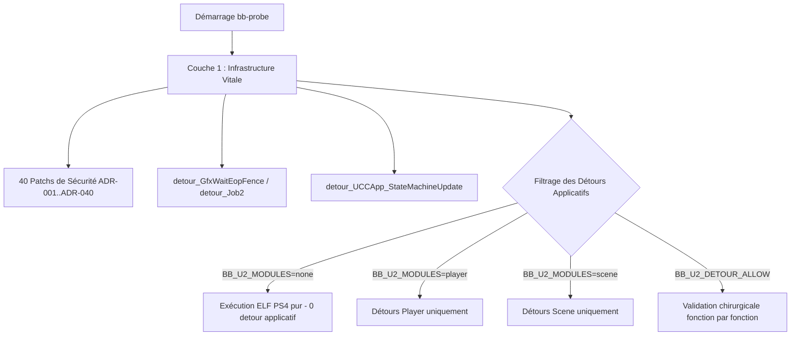

# Guide de Validation et d'Audit des Détours C Natifs (Uncharted 2 PC)

> Ce document définit la méthodologie officielle et l'architecture technique permettant de tester, valider et isoler les **930+ fonctions décompilées en C natif** (`src/runtime_u2_*.c`) exécutées conjointement avec l'ELF PS4 (`eboot.elf`).

---

## 1. Contexte & Problématique

Dans `uncharted_pc`, le binaire hôte (`bb-probe.exe`) combine deux moteurs d'exécution :
1. **Le code PS4 original** (`eboot.elf`) : tournant directement sur le CPU x86-64 hôte avec redirection des accès registres/mémoire.
2. **Le runtime C natif** (`src/runtime_u2_*.c`) : réimplémentations manuelles et décompilations par lots (Lots 1 à 25) couvrant plus de 930 fonctions réparties en 5 sous-systèmes (`player`, `npc`, `scene`, `event`, `audio`).

### Le Risque des Régressions Silencieuses
Lorsqu'un detour natif est activé, il remplace du code assembleur validé par Naughty Dog. Si une fonction native présente :
* Un décalage d'offset dans une structure interne Naughty Dog (DC / Component),
* Une divergence de convention d'appel (SysV ABI vs Microsoft x64, préservation des registres callee-saved `rbx`, `r12-r15`),
* Une valeur de retour non conforme ou un écrasement de `%rax` lors du saut `write_detour_jmp64`,
* Une boucle infinie ou un débordement de pile,

le moteur subit un crash ou un blocage en aval (écran noir, freeze d'image, désynchronisation des fibres).

---

## 2. Découplage Architectural : Infrastructure vs Modules Applicatifs

Pour tester les détours un à un, le système d'injection dans [`src/runtime_u2_script.c`](file:///c:/Users/Yohan/Desktop/uncharted_pc-0.3.3/src/runtime_u2_script.c) doit distinguer strictement deux catégories :



### Couche 1 : L'Infrastructure Vitale (Toujours Active)
Ne doit **jamais** être désactivée par un commutateur global :
* **State Machine & Boot** : `detour_UCCApp_StateMachineUpdate` (`0x00D59A50`), `detour_IntroState_Update` (`0x00A551B0`).
* **Synchronisation GPU / CPU** : `detour_GfxWaitEopFence` (`0x00B29F10`), `detour_Job2` (`0x003F68C0`), `hook_JobDispatch` (`0x00B3DB04`).
* **Gardes Mémoire et Allocateurs** : Patchs d'architecture ADR-001 à ADR-040 (FIOS2, PlayGo, EOP tick, audio caves, bounds checks).

### Couche 2 : Les Détours Applicatifs Modulaires (Testables un à un)
Les 930 fonctions regroupées par tables dans `s_module_getters` :
1. `u2_get_player_detours` (~100 fonctions : animations, stick, mouvements de Drake)
2. `u2_get_scene_detours` (~400 fonctions : caméras, splines, rails, streaming)
3. `u2_get_event_detours` (~150 fonctions : triggers, cutscenes, événements)
4. `u2_get_npc_detours` (~200 fonctions : comportement et physique des ennemis)
5. `u2_get_audio_detours` (~80 fonctions : filtres DSP, matrices audio)

---

## 3. Protocole de Validation en 4 Paliers

### Palier 0 : La Baseline "ELF Pur"
* **Objectif** : Vérifier que le moteur démarre, avance dans ses frames et initialise le rendu Vulkan sans **aucun** détour applicatif natif.
* **Configuration** : `BB_U2_MODULES=none`
* **Critère de succès** : Le cycle de boucle `AppMainLoop` tourne de manière stable sans interruption.

### Palier 1 : Validation Granulaire par Module
Activer un seul sous-système à la fois :
```powershell
# Test du module Player seul
$env:BB_U2_MODULES="player"
powershell -File scratch/run_test.ps1 10

# Test du module Scene seul
$env:BB_U2_MODULES="scene"
powershell -File scratch/run_test.ps1 10
```
* **Critère de succès** : Le jeu conserve la même stabilité que le Palier 0. Si un crash apparaît, le sous-système défaillant est identifié immédiatement.

### Palier 2 : Diagnostic par Dichotomie (Isolation Chirurgicale)
Lorsqu'un module provoque une anomalie :
1. Diviser les adresses virtuelles du module en deux moitiés (`0x00A00000 - 0x00B00000` et `0x00B00000 - 0x00D00000`).
2. Appliquer le filtre via `BB_U2_DETOUR_RANGE=min-max`.
3. Réduire l'intervalle par deux à chaque exécution.
4. En **moins de 8 essais**, la fonction exacte causant le conflit est isolée.

### Palier 3 : Traçage Télémétrique des Appels
Pour savoir exactement quelles fonctions C natives sont invoquées par le jeu au cours de la frame :
* Chaque entrée de detour peut journaliser son premier appel :
  ```c
  [Detour Hit] 0x00A14120: ExecuteScriptCode (caller=0x003F43BE)
  ```
* En cas d'exception, le journal indique précisément le dernier detour actif avant l'anomalie.

---

## 4. Checklist de Conformité d'une Fonction C Native

Avant de valider définitivement un detour :
- [ ] **Convention ABI** : Utilise le macro `ABI` (`__attribute__((sysv_abi))` ou équivalent) pour toute fonction appelée depuis l'ELF guest.
- [ ] **Préservation des Registres** : Les registres `rbx`, `rsp`, `rbp`, `r12`, `r13`, `r14`, `r15` doivent être strictement conservés conformément à la convention SysV.
- [ ] **Contrôle des Pointeurs NULL** : Tout pointeur d'instance (`this`) ou de ressource transmis par l'ELF doit être validé (`if (!ptr || (uintptr_t)ptr < 0x10000) return ...`).
- [ ] **Alignement Mémoire** : Tout accès SIMD/AVX (`vmovaps`) doit garantir un alignement de 16 ou 32 octets sous peine d'interruption matérielle.
- [ ] **Valeur de Retour** : S'assurer que le registre de retour (`rax` ou `xmm0`) correspond fidèlement au comportement attendu par le code assembleur original.

---

## 5. Commandes de Référence

```powershell
# Compilation propre MSYS2 CLANG64
powershell -ExecutionPolicy Bypass -File scratch/build_msys2.ps1

# Test standard (10s)
powershell -ExecutionPolicy Bypass -File scratch/run_test.ps1 10

# Audit de la base de mapping
node scratch/audit_detours.js

# Rapport d'avancement
node scratch/status_report.js
```

---

## 6. Journal des Jalons Validés

* **Milestone Phase 4 — Palier B (Lot 2 : 24 Méthodes Moteur C++23 Boot, Process, Settings, TaskGraph, PlayGo, SaveBuffer & HUD — 55 Méthodes C++23 / 889 Détours Actifs)** :
  - **Arbre de Processus & Ordonnancement (`process.cpp`, `process-mgr.cpp`, `processlist.cpp` -> `src/u2_engine/process_system.cpp`)** :
    - `ProcessMgr_LookupProcessByPid` (`0x009BBCF0`), `Process_LookupProcessByPid` (`0x009BEF30`), `Process_ValidateInternalPointer` (`0x009BE660`), `ProcessMgr_AddProcessForScriptUpdate` (`0x009B8CD0`), `ProcessList_Alloc` (`0x009B0D70`)
    - Accesseurs d'état et propriétés `Process` (`0x001FE420` `Process_DMenuStateProp`, `0x001FE7E0` `Process_DMenuFloatProp_354`, `0x001FE8C0` `Process_DMenuBoolProp_43A`, `0x001FE980` `Process_DMenuBoolProp_43F`, `0x001FECA0` `Process_DMenuBoolProp_439`, `0x001FED70` `Process_DMenuBoolProp_438`, `0x001FEE40` `Process_DMenuBoolProp_43B`)
  - **Sauvegardes, Paramètres, Graphe de Tâches, PlayGo & HUD (`savebuffer.cpp`, `settings.cpp`, `task.cpp`, `game-loading.cpp`, `hud.cpp` -> `src/u2_engine/save_hud.cpp`)** :
    - `SaveBuffer_InitExternal` (`0x00CD0E10`), `SaveBuffer_DebugSetBuffer` (`0x00CD0E80`), `SaveBuffer_CopyFrom` (`0x00CD0EE0`), `SaveBuffer_WriteBytes` (`0x00CD16A0`), `SaveBuffer_WriteU64Count0` (`0x00CD1730`), `SaveBuffer_WriteU64Count1` (`0x00CD17C0`)
    - `Hud_FreeGrenadeIndicator` (`0x00554F70`), `Hud_ShowGrenadeIndicator` (`0x00554FD0`)
    - `GameTask_cbCollectTaskNode` (`0x00A5F970`), `Settings_FreeSetting` (`0x00A1D600`)
    - `GameLoading_IsChunkSetEntirelyWithin` (`0x00B77AA0`), `GameLoading_GetPlayGoSpeed` (`0x00B770D0`)
  - **Correctifs Critiques Boot / Splash Screen & Menu (`36daaf2`, `80bffda`)** :
    - Protection ABI dans `u2_set_status` (`src/runtime_u2_common.h`) empêchant toute écriture de `0` dans `%rdx` lorsqu'un détour `Dc*` (`DcKillAllAttachables` `0x009F2BF0`) est invoqué directement depuis le C++ avec un pointeur `Process *` dans `%rdx`.
    - Correction de la signature à 5 registres et du chaînage free-list `+0x00` dans `detour_ScriptManager_Run` (`0x00A14F20`), et arguments optionnels dans `DcAddLoadModule` / `DcAddImportModule`.
  - **Validation Unitaire & Runtime (20s)** :
    - **831/831 détours `Dc*` validés en Full-Body Sandbox** via trampolines ELF + **65/65 assertions fonctionnelles C++23** (`[U2 EngineTest] PASSED`), **889 détours actifs simultanément**, test live 20s complet (splash screen -> montage `SAVEDATA02P`/`SAVEDATA0CC` -> résolution 1920x1080 -> `STOPPED_AFTER_TIMEOUT` avec 0 crash).

* **Milestone Phase 4 — Palier B (Lot 1 : 31 Méthodes Moteur C++ Pures — 868 Détours C Actifs)** :
  - **Splines & Trackers (`catmull-rom.cpp`, `catmull-rom-manager.cpp`, `spline-tracker.cpp`, `vehicle-spline-tracker.cpp`)** :
    - `CatmullRomSpline_GetName` (`0x00468260`), `CatmullRomSpline_IsLooped` (`0x004684C0`), `CatmullRomSpline_GetControlPointCount` (`0x00468520`), `CatmullRomSpline_GetTotalArcLength` (`0x00468D90`), `CatmullRomSpline_GetCumulSegArcLength` (`0x00469F60`)
    - `CatmullRomManager_OnSpawnGameObject` (`0x004643E0`), `CatmullRomManager_OnDestroyGameObject` (`0x00464490`), `CatmullRomManager_RemoveSpline` (`0x00465240`), `CatmullRomManager_WalkSplines` (`0x00466320`)
    - `SplineTracker_GetSpline0` (`0x00A24040`), `SplineTracker_GetSpline1` (`0x00A24080`), `SplineTracker_GetSplineNameId` (`0x00A240C0`), `SplineTracker_FinalizeDistance` (`0x00A24110`)
    - `VehicleSplineTracker_GetCurrentVirtualDistance_m` (`0x00ABA7B0`), `VehicleSplineTracker_GetCurrentRealDistance_m` (`0x00ABA840`)
  - **Caméra (`camerazoom.cpp`)** :
    - `CameraZoom_OverideHorizontalAngularConstraints` (`0x0044BF00`), `CameraZoom_ClearHorizontalAngularConstraints` (`0x0044BFA0`), `CameraZoom_OverideVerticalAngularConstraints` (`0x0044BFE0`), `CameraZoom_ClearVerticalAngularConstraints` (`0x0044C060`), `CameraZoom_SetDefaultVerticalAngularConstraints` (`0x0044C090`)
  - **Véhicules sur Rail (`rail-vehicle.cpp`, `rail-vehicle-behavior.cpp`, `rail-vehicle-manager.cpp`)** — remplacement du code `-O0` PS4 (`#pragma clang optimize off`) et des assertions `int $0x41` par du code C natif `-O2` :
    - `RailVehicle_InitBehavior` (`0x000013D0`), `RailVehicle_SetFollowDistance` (`0x00001460`), `RailVehicle_GetVehicleClass` (`0x00001DD0`), `RailVehicle_ResetWheels` (`0x00001ED0`), `RailVehicle_GetDamageable` (`0x00002430`), `RailVehicle_OnIgcBind` (`0x00005630`), `RailVehicle_OnIgcUnbind` (`0x000056E0`)
    - `RailVehicleBehavior_GetDcBehavior` (`0x00A8DE50`), `RailVehicleBehaviorContainer_GetCurrentBehavior` (`0x00A8EA30`)
    - `RailVehicleManager_GetMover` (`0x00A8FCE0`), `RailVehicleManager_DetachFromRail` (`0x00A903E0`)
  - **Validation Self-Test & Runtime** :
    - `BB_U2_SELFTEST=1` activé par défaut dans `scratch/auto_test.py` (support hybride fonctions `Dc*` + méthodes C++ moteur).
    - **862/862 fonctions testées au démarrage sans faute (`PASSED`)**, **868 détours C actifs simultanément**, test live 8s `STOPPED_AFTER_TIMEOUT` avec 0 crash.

* **Milestone 832/832 (100% Exécutables DC + VM Native C + Harnais Self-Test)** :
  - **Lot 24 Final (5/5 fonctions restantes)** :
    - `DcCSpawnNpc` (`0x002E57B0`)
    - `DcCSpawnNpcS` (`0x002E55A0`)
    - `DcAddLoadModule` (`0x00A0FE90`)
    - `DcAddImportModule` (`0x00A0FF10`)
    - `DcKillAllAttachables` (`0x009F2BF0`)
  - **Assainissement "Edge-Cases" Automatisé (`BB_U2_SELFTEST=1`)** :
    - Ajout de 238 gardes `!argv`, 98 gardes `!g_u2_image_base`, et remplacement de 514 écritures directes `*status` par `u2_set_status()`.
    - Validation unitaire par fuzzing automatique au démarrage : **831/831 fonctions testées sans crash** (`[U2 SelfTest] PASSED`).
  - **Cœur VM Script 100 % Natif C activé par défaut** :
    - `ExecuteScriptCode=NATIVE_C` (`0x00A14120`), `EvalEx=NATIVE_C` (`0x00A15430`), `ScriptManager::Run=NATIVE_C` (`0x00A14F20`) — **837 détours C actifs simultanément** sans aucun crash runtime (`STOPPED_AFTER_TIMEOUT`).

* **Milestone 827/843** : 827 fonctions DC natives réécrites en C (`ABI`) - Lot 23 (méga-batch de 40 fonctions Rails & Trains) validé unitairement sans crash (test 20s avec FSR 3 / boot menu complet) :
  - `DcRailActivateMover` (`0x00AB8340`)
  - `DcRailAnimateToMover` (`0x00AB8130`)
  - `DcRailDeactivate` (`0x00AB97D0`)
  - `DcRailDisableCareen` (`0x00AB8B80`)
  - `DcRailEnableCollideWithObjects` (`0x00AB8EA0`)
  - `DcRailEnableGroundHug` (`0x00AB8430`)
  - `DcRailEnableTributary` (`0x00AB96B0`)
  - `DcRailEnableTruckJump` (`0x00AB9BB0`)
  - `DcRailFireTurretGrenade` (`0x00AB8CD0`)
  - `DcRailFollowMover` (`0x00AB81E0`)
  - `DcRailForceCareen` (`0x00AB8C40`)
  - `DcRailGetMoverLocator` (`0x00AB7D00`)
  - `DcRailGetSpline` (`0x00AB84E0`)
  - `DcRailHasVehicle` (`0x00AB94B0`)
  - `DcRailOverrideSfxState` (`0x00AB9070`)
  - `DcRailScrub` (`0x00AB8F90`)
  - `DcRailSetAcceleration` (`0x00AB9590`)
  - `DcRailSetAllVehiclesToMoverSpeed` (`0x00AB7BF0`)
  - `DcRailSetFollowDistance` (`0x00AB8560`)
  - `DcRailSetMoverFollowDistance` (`0x00AB7FD0`)
  - `DcRailSetMoverIntialDistance` (`0x00AB7E80`)
  - `DcRailSetMoverSpeed` (`0x00AB80A0`)
  - `DcRailSetSpeed` (`0x00AB9230`)
  - `DcRailShutdown` (`0x00AB9340`)
  - `DcRailSpawn` (`0x00AB9920`)
  - `DcRailUseFixedAprefInIgc` (`0x00AB9410`)
  - `DcTrainAllowUnphysicalize` (`0x00A68430`)
  - `DcTrainDecouple` (`0x00A67E40`)
  - `DcTrainGetAcceleration` (`0x00A68230`)
  - `DcTrainGetDistance` (`0x00A67B90`)
  - `DcTrainGetHeadCar` (`0x00A67C40`)
  - `DcTrainGetSpline` (`0x00A67AE0`)
  - `DcTrainKillAllRiders` (`0x00A68530`)
  - `DcTrainSetAcceleration` (`0x00A68140`)
  - `DcTrainSetSpeedMph` (`0x00A67F60`)
  - `DcTrainSpawn` (`0x00A67960`)
  - `DcTrainSpawnOnTrack` (`0x00A68740`)
  - `DcTrainTeleport` (`0x00A67CD0`)
  - `DcTrainTrackPlayer` (`0x00A68300`)
  - `DcTrainTransferPendingP` (`0x00A685E0`)

* **Milestone 787/843** : 787 fonctions DC natives réécrites en C (`ABI`) - Lot 22 (méga-batch de 52 fonctions Tank, Task, Waits & Spawners) validé unitairement sans crash (test 20s avec FSR 3 / boot menu complet) :
  - `DcXSpawnNpcAt` (`0x00A64C40`)
  - `DcSpawnAttachable` (`0x00A0F540`)
  - `DcTankDistToPoint` (`0x00AA1300`)
  - `DcTankFindBestTargetMP` (`0x00AA4950`)
  - `DcTankFire` (`0x00AA2930`)
  - `DcTankFireAtObj` (`0x00AA2EE0`)
  - `DcTankFireAtPos` (`0x00AA2F30`)
  - `DcTankForceFireCannon` (`0x00AA42C0`)
  - `DcTankGetHealth` (`0x00AA3D80`)
  - `DcTankMgCeaseFire` (`0x00AA2000`)
  - `DcTankMgFireAtLoc` (`0x00AA2120`)
  - `DcTankMgFireAtObj` (`0x00AA2680`)
  - `DcTankMoveTo` (`0x00AA33E0`)
  - `DcTankMoveTrackingObject` (`0x00AA1550`)
  - `DcTankReverseTo` (`0x00AA2F80`)
  - `DcTankSetHealth` (`0x00AA3CC0`)
  - `DcTankTeleport` (`0x00AA1BA0`)
  - `DcTankWaitTeleport` (`0x00AA4420`)
  - `DcTaskElapsedTime` (`0x00A102B0`)
  - `DcTaskFailed` (`0x009FE900`)
  - `DcTaskFind` (`0x009FEB90`)
  - `DcTaskNodeActiveP` (`0x00A10340`)
  - `DcTaskSubnodeComplete` (`0x009FECA0`)
  - `DcTaskSubnodePlay` (`0x009FEC00`)
  - `DcTransferToSpline` (`0x00A25A90`)
  - `DcTranslateYLoop` (`0x009FC590`)
  - `DcUnstickySpawner` (`0x00A0B7C0`)
  - `DcWait` (`0x00A3E690`)
  - `DcWaitBoolean` (`0x00A41610`)
  - `DcWaitFor` (`0x00A3FC50`)
  - `DcWaitFrames` (`0x00A41270`)
  - `DcWaitHeliFireMissile` (`0x00A7EE30`)
  - `DcWaitHeliMoveTo` (`0x00A7FA70`)
  - `DcWaitHeliMoveToSpline` (`0x00A7F800`)
  - `DcWaitInt32` (`0x00A41D40`)
  - `DcWaitOneFrame` (`0x00A40F70`)
  - `DcWaitPlayerMoveTo` (`0x00A0B350`)
  - `DcWaitPlayerTurnTo` (`0x00A0AFC0`)
  - `DcWaitSay` (`0x00A016D0`)
  - `DcWaitSpawnEntity` (`0x00A09E90`)
  - `DcWaitSpawnEntityAt` (`0x00A09DC0`)
  - `DcWaitSplineDistance` (`0x00A25740`)
  - `DcWaitTankAimAtObj` (`0x00AA3A40`)
  - `DcWaitTankAimAtPos` (`0x00AA3AA0`)
  - `DcWaitTankAimForward` (`0x00AA3430`)
  - `DcWaitTankFireAtObj` (`0x00AA3B00`)
  - `DcWaitTankFireAtPos` (`0x00AA3B60`)
  - `DcWaitTankMoveTo` (`0x00AA3C60`)
  - `DcWaitTankReverseTo` (`0x00AA3BC0`)
  - `DcWaitUntil` (`0x00A40E60`)
  - `DcWaitUntilFrame` (`0x00A40D40`)
  - `DcWaitUntilNetTime` (`0x00A40870`)

* **Milestone 735/843** : 735 fonctions DC natives réécrites en C (`ABI`) - Lot 21 (méga-batch de 50 fonctions Scene) validé unitairement sans crash (test 20s avec FSR 3 / boot menu complet) :
  - `DcUnhideMessage` (`0x005DCAF0`)
  - `DcUnhideMessageDeprecated` (`0x005DC700`)
  - `DcBattleSelectBestSpawnerFromGroup` (`0x00A11190`)
  - `DcCameraAimOverridePoint` (`0x00A0DF40`)
  - `DcCameraEnable` (`0x00A0E680`)
  - `DcCameraLocator` (`0x00A128B0`)
  - `DcEmitBulletFromSpawner` (`0x00A0BF40`)
  - `DcFmaRequestPartModule` (`0x00A00050`)
  - `DcGetSpawnerLocator` (`0x00A09330`)
  - `DcGetSpawnerLocatorProjected` (`0x00A08D10`)
  - `DcGetSpawnerLocatorRadial` (`0x00A088C0`)
  - `DcGetSpawnerPosition` (`0x00A094B0`)
  - `DcGroupSpawnedCount` (`0x00549BF0`)
  - `DcHeliMoveTo` (`0x00A7FEE0`)
  - `DcHeliMoveToSpline` (`0x00A7FDD0`)
  - `DcKillPartSpawner` (`0x00A099B0`)
  - `DcLevelsFullySpawnedIgnorePlayerP` (`0x009FE400`)
  - `DcLevelsFullySpawnedP` (`0x009FE5E0`)
  - `DcMakeVector` (`0x009FDCF0`)
  - `DcMakeVector3` (`0x009FDC20`)
  - `DcReloadModule` (`0x00A19200`)
  - `DcReloadParticleModule` (`0x00A19180`)
  - `DcSelectBestSchemaSpawner` (`0x00A10EB0`)
  - `DcSetCollisionLayer` (`0x00A03CD0`)
  - `DcSetCurrentBySpawner` (`0x009FD710`)
  - `DcSetDefaultFollowCameraSettings` (`0x00A0EBF0`)
  - `DcSetObjectFaction` (`0x009FCF40`)
  - `DcSetOffBalanceBySpawner` (`0x008E9160`)
  - `DcSpawnEntity` (`0x00A09F40`)
  - `DcSpawnEntityAt` (`0x009F3900`)
  - `DcSpawnExplosion` (`0x009FF610`)
  - `DcSpawnExplosionNpcOnly` (`0x009FF410`)
  - `DcSpawnFloatingBarrelAtPhase` (`0x00A03E20`)
  - `DcSpawnMessage` (`0x005DC7B0`)
  - `DcSpawnParticlesAtLocator` (`0x00A002D0`)
  - `DcSpawnScript` (`0x00A44460`)
  - `DcSplineActivate` (`0x00A26180`)
  - `DcSplineDistanceLocator` (`0x00A25F60`)
  - `DcSplineDistanceSpawner` (`0x00A260E0`)
  - `DcSplineDistanceVehicleAnimation` (`0x00AB8640`)
  - `DcSplineLengthP` (`0x00A256B0`)
  - `DcSplineLocatorAtDistance` (`0x00EA2315`)
  - `DcSsError` (`0x00A44670`)
  - `DcStickySpawner` (`0x00A0B8F0`)
  - `DcStopSpeaking` (`0x00A01570`)
  - `DcSwapEntity` (`0x00A09590`)
  - `DcTankAimAtObj` (`0x00AA2AC0`)
  - `DcTankAimAtPos` (`0x00AA2E90`)
  - `DcTankAimAtPosInstant` (`0x00AA2B10`)
  - `DcTankAimForward` (`0x00AA2A70`)

* **Milestone 685/843** : 685 fonctions DC natives réécrites en C (`ABI`) - Lot 20 (méga-batch de 50 fonctions Scene) validé unitairement sans crash (test 20s avec FSR 3 / boot menu complet) :
  - `DcCameraAimOverrideDirection` (`0x00A0DE40`)
  - `DcIncrementStatDifficulty` (`0x0097C010`)
  - `DcIsCameraStickPressed` (`0x00A0D610`)
  - `DcIsOnScreen` (`0x009FD200`)
  - `DcIsSpeaking` (`0x00A013F0`)
  - `DcIsStickPressedTowards` (`0x00A0D6B0`)
  - `DcJournalDisable` (`0x00A10510`)
  - `DcKillDroppedWeaponsInSphere` (`0x00A09B10`)
  - `DcLayerToScriptControllerIndices` (`0x00EA2F7E`)
  - `DcLerpReflectionPlanesByRotation` (`0x00A02A20`)
  - `DcMakeActiveCharacterMoreWet` (`0x00A020E0`)
  - `DcMakeCharacterMoreWet` (`0x00A023C0`)
  - `DcMirrorAimingAt` (`0x009FC990`)
  - `DcObjectInRegionP` (`0x00A0FCA0`)
  - `DcObjectOnObjectP` (`0x00A04040`)
  - `DcOfferContextualEntity` (`0x00A3FB60`)
  - `DcOfferContextualProcess` (`0x00A3FA50`)
  - `DcPadGetGestureInterval` (`0x00A0CEF0`)
  - `DcPadGetInfo` (`0x00A0D210`)
  - `DcPredictOnPhysicsDriven` (`0x00A037C0`)
  - `DcPrintf` (`0x00A10110`)
  - `DcRemoveContextualEntity` (`0x00A3F960`)
  - `DcRenameObject` (`0x00A04D10`)
  - `DcResetStat` (`0x0097BE50`)
  - `DcReverseLocator` (`0x00A05CB0`)
  - `DcRotateLocatorAngle` (`0x00A05090`)
  - `DcRotateLocatorLookat` (`0x00A05620`)
  - `DcSayPreRoll` (`0x00A019F0`)
  - `DcSetBoolean` (`0x00A42060`)
  - `DcSetCharacterWetMask` (`0x00A02550`)
  - `DcSetCharacterWetMaskValue` (`0x00A026E0`)
  - `DcSetClockMultiplier` (`0x00A0EE60`)
  - `DcSetFloat` (`0x00A42630`)
  - `DcSetFocusableIgnore` (`0x00A0F3C0`)
  - `DcSetIceCaveStupidGearsHack` (`0x009FCC50`)
  - `DcSetInt32` (`0x00A42350`)
  - `DcSetRagdollFlow` (`0x009FD5C0`)
  - `DcSetRenderSettings` (`0x009FFF80`)
  - `DcSetShaderInstanceParam` (`0x00A107B0`)
  - `DcSetShaderMaterialParam` (`0x00A10DD0`)
  - `DcSetSingleShaderInstanceParam` (`0x00A10A50`)
  - `DcSetSplineFollowAcceleration` (`0x00A25CB0`)
  - `DcSetSplineFollowDistance` (`0x00A25C00`)
  - `DcSetSplineFollowSpeed` (`0x00A25D60`)
  - `DcSetSymbol` (`0x00A42910`)
  - `DcSetTableShaderMaterialValuesParam` (`0x009F3B70`)
  - `DcShowBinoculars` (`0x00A0CB90`)
  - `DcShutUp` (`0x00A011E0`)
  - `DcSignal` (`0x00A40480`)
  - `DcSlaForceTackle` (`0x00A0F4A0`)

* **Milestone 635/843** : 635 fonctions DC natives réécrites en C (`ABI`) - Lot 19 (méga-batch de 50 fonctions) validé unitairement sans crash (test 20s avec FSR 3 / boot menu complet) :
  - `DcCameraLocalSpace` (`0x00A0EA20`)
  - `DcForceAimingCameraUltraTight` (`0x00A03670`)
  - `DcForceNoShiftCameraZoomMode` (`0x00A035E0`)
  - `DcForceStealthOff` (`0x00A0BC40`)
  - `DcForgetSignal` (`0x00A3FF40`)
  - `DcFreezeBindingWhenNonPhysical` (`0x00A03700`)
  - `DcGetActionPackLocator` (`0x00A060C0`)
  - `DcGetAlignLocator` (`0x00A066F0`)
  - `DcGetApReferenceEffectLocator` (`0x00A07340`)
  - `DcGetApReferenceLocator` (`0x00A07990`)
  - `DcGetApReferenceLocatorRadial` (`0x00A06C20`)
  - `DcGetBoolean` (`0x00A42BF0`)
  - `DcGetCurrentTime` (`0x00A44800`)
  - `DcGetFloat` (`0x00A43170`)
  - `DcGetInt32` (`0x00A42EB0`)
  - `DcGetJointAngleDiffFromBindpose` (`0x00A06180`)
  - `DcGetJointLocator` (`0x00A07E80`)
  - `DcGetJointPosition` (`0x00A120C0`)
  - `DcGetLocatorDistance` (`0x00A0EF50`)
  - `DcGetObjectLocator` (`0x00A08630`)
  - `DcGetObjectLocatorRadial` (`0x00A081A0`)
  - `DcGetObjectOffsetLocator` (`0x00A121E0`)
  - `DcGetObjectOffsetPosition` (`0x00A12390`)
  - `DcGetObjectPosition` (`0x00A12610`)
  - `DcGetObjectState` (`0x00A04C10`)
  - `DcGetOriginLocator` (`0x00A05F60`)
  - `DcGetPlayerAimTime` (`0x005DCBA0`)
  - `DcGetQuaternionPitch` (`0x009F37C0`)
  - `DcGetScriptState` (`0x00A44290`)
  - `DcGetStatValue` (`0x0097BD10`)
  - `DcGetStateTime` (`0x00A44960`)
  - `DcGetSymbol` (`0x00A43440`)
  - `DcGrabRope` (`0x00A04740`)
  - `DcGrenadeDirectorChangeSettings` (`0x0069B910`)
  - `DcGroupAnd` (`0x0054AFD0`)
  - `DcGroupAt` (`0x0054A6B0`)
  - `DcGroupCount` (`0x00549810`)
  - `DcGroupIsMemberSymbolP` (`0x0054A250`)
  - `DcGroupOr` (`0x0054A760`)
  - `DcHeliAnimateGun` (`0x00A7ECD0`)
  - `DcHeliFireMissile` (`0x00A7F140`)
  - `DcHeliSetBasePitch` (`0x00A7EC00`)
  - `DcHeliSetFiringState` (`0x00A7F5C0`)
  - `DcHeliSetHover` (`0x00A7ED80`)
  - `DcHeliSetMgStats` (`0x00A7F6B0`)
  - `DcHeliSetTargetLocator` (`0x00A7F2E0`)
  - `DcHeliSetTargetObject` (`0x00A7F4A0`)
  - `DcHideMessage` (`0x005DCA40`)
  - `DcHideMessageDeprecated` (`0x005DC650`)
  - `DcInFrontOfTankP` (`0x00AA3E10`)
* **Milestone 585/843** (`0c203d3`) : 585 fonctions DC natives réécrites en C (`ABI`) - Lot 18 (méga-batch de 50 fonctions) validé unitairement sans crash (test 20s avec FSR 3 / boot menu complet) :
  - `DcGetAnimationPhase` (`0x003976C0`)
  - `DcHasAnimP` (`0x00397A20`)
  - `DcPlayerSetProneMode` (`0x009089D0`)
  - `DcPlayerSetTeachingComboMode` (`0x00909330`)
  - `DcPlayerTakeMeleeDamage` (`0x009101A0`)
  - `DcPlayerTrainWreckDynoJumpHack` (`0x0090E050`)
  - `DcPlayerTurnTo` (`0x00A0B2D0`)
  - `DcPlayerUseLargeNpcEdgeCollision` (`0x0090E400`)
  - `DcSetAnimationSpeed` (`0x00397880`)
  - `DcSetCoverPushBackDist` (`0x0090B060`)
  - `DcSetLookatStopPhase` (`0x00397320`)
  - `DcSetMinFallDist` (`0x0090E660`)
  - `DcSetMoveMode` (`0x0090D4F0`)
  - `DcSetPlayerCanOnlyDrawPistol` (`0x0090B9E0`)
  - `DcSetPlayerClimbSpawner` (`0x0090E540`)
  - `DcSetPlayerInCombat` (`0x0090DB40`)
  - `DcSetPlayerInvincible` (`0x0090BB10`)
  - `DcSetPlayerJumpSpawner` (`0x0090EF70`)
  - `DcSetPlayerMaxFallHeight` (`0x00906EE0`)
  - `DcSetPlayerNoIgcKillGrenade` (`0x0090E910`)
  - `DcSetPlayerOnCollapsingBuilding` (`0x0090F0F0`)
  - `DcSetReloadPistolIfEmpty` (`0x0090B940`)
  - `DcSetReverseJumpEnable` (`0x0090D140`)
  - `DcSetRunType` (`0x0090D1F0`)
  - `DcSetTargetSpawnerAngle` (`0x0090FE30`)
  - `DcSetWalkType` (`0x0090D350`)
  - `DcStopAnimating` (`0x00397AB0`)
  - `DcSwimAllowStandOnBottom` (`0x0090D6B0`)
  - `DcUpdateApRef` (`0x00397520`)
  - `DcWaitAnimate` (`0x003969A0`)
  - `DcNpcUseScriptedAp` (`0x002DE250`)
  - `DcNpcUsingSkillP` (`0x002E3CB0`)
  - `DcNpcsGetPlayerPosition` (`0x002DE830`)
  - `DcSetHealthParameters` (`0x002DAAA0`)
  - `DcThrowGrenade` (`0x002E2C30`)
  - `DcThrowSlaGrenade` (`0x002E2810`)
  - `DcWaitForNpcNotBusy` (`0x002DF6A0`)
  - `DcWaitNpcBind` (`0x002E1E80`)
  - `DcWaitNpcLeaveScriptedAp` (`0x002DDD20`)
  - `DcWaitNpcMoveTo` (`0x002E15F0`)
  - `DcWaitNpcMoveToSpawner` (`0x002E0F10`)
  - `DcWaitNpcTurnTo` (`0x002DF9A0`)
  - `DcWaitNpcUseClosestCover` (`0x002E4130`)
  - `DcWaitNpcUseScriptedAp` (`0x002DDF20`)
  - `DcEndScript` (`0x00A44190`)
  - `DcFacingPointP` (`0x00A0F6D0`)
  - `DcFireWeapon` (`0x00A0C930`)
  - `DcFireWeaponAtTarget` (`0x00A0C4C0`)
  - `DcFollowSpline` (`0x00A25E50`)
  - `DcForGroup` (`0x0054B830`)
* **Milestone 535/843** (`974c33b`) : 535 fonctions DC natives réécrites en C (`ABI`) - Lot 17 (méga-batch de 50 fonctions) validé unitairement sans crash (test 20s avec FSR 3 / boot menu complet) :
  - `DcSendEvent` (`0x004C18F0`)
  - `DcSendSimpleEvent` (`0x004C1CF0`)
  - `DcUpdateFightRef` (`0x00667F80`)
  - `DcDisableEdgeGrab` (`0x0090CE40`)
  - `DcDisableFollowCameraCollision` (`0x0090F4F0`)
  - `DcDisableForceLedgeDrop` (`0x0090CB20`)
  - `DcDisableLookAroundDof` (`0x0090FD30`)
  - `DcDisableLowCoverExitAround` (`0x0090FC30`)
  - `DcDisablePlayerCoverExit` (`0x00906950`)
  - `DcForceCollisionForAimFocus` (`0x00906F90`)
  - `DcForceDeathCamera` (`0x0090EFF0`)
  - `DcForceDistanceStopIncrease` (`0x00906740`)
  - `DcForceHighLedgeDrop` (`0x0090F630`)
  - `DcForceUboatCollision` (`0x0090C960`)
  - `DcGetGrappleApRef` (`0x009102C0`)
  - `DcGetPlayerCarriedObject` (`0x009068C0`)
  - `DcGetPlayerEdgeBbject` (`0x0090DCA0`)
  - `DcGetPlayerPlatform` (`0x0090CF40`)
  - `DcKillPlayer` (`0x0090C790`)
  - `DcKillPlayerNoAnim` (`0x0090C5F0`)
  - `DcPlayerSetCarryNpcCamOffset` (`0x0090E170`)
  - `DcPlayerSetCarryNpcSlowWalk` (`0x0090FF30`)
  - `DcPlayerSetDynoJumpAimAngle` (`0x0090E0F0`)
  - `DcClearLookAt` (`0x002E4830`)
  - `DcCoverThrowGrenadeAnim` (`0x002E4070`)
  - `DcLookAt` (`0x002E4C80`)
  - `DcLookAtObject` (`0x002E4A40`)
  - `DcNpcSetZoneMarker` (`0x002E3AA0`)
  - `DcNpcSetZoneRadius` (`0x002E3280`)
  - `DcNpcSetZoneUpdateMethod` (`0x002DCF50`)
  - `DcNpcSetZoneYThreshold` (`0x002E3110`)
  - `DcNpcShowHitEffects` (`0x002DD1F0`)
  - `DcNpcSniperDisableWatchArea` (`0x002DB890`)
  - `DcNpcSniperSetWatchArea` (`0x002DB980`)
  - `DcNpcStop` (`0x002DBF50`)
  - `DcNpcSwapWithRagdoll` (`0x002DACE0`)
  - `DcNpcTakeWeapon` (`0x002DB320`)
  - `DcNpcTargetInZoneP` (`0x002E2F20`)
  - `DcNpcThrowGrenadeAtPlayer` (`0x002E2350`)
  - `DcNpcTrackPlayerWhileBound` (`0x002E1C40`)
  - `DcNpcUpdateMoveDest` (`0x002E01D0`)
  - `DcNpcUseCap` (`0x002E3F60`)
  - `DcNpcUseClosestCover` (`0x002E43B0`)
  - `DcAllowCameraCutCompensate` (`0x00A0DD40`)
  - `DcDisableCoverCamera` (`0x00A0E290`)
  - `DcDisableMessage` (`0x005DC990`)
  - `DcDisplayMessage` (`0x009FE140`)
  - `DcDumpEntityInfo` (`0x00A04970`)
  - `DcEnableActionPack` (`0x00A0A060`)
  - `DcEnableMessage` (`0x005DC8E0`)
* **Milestone 485/843** (`e4deb54`) : 485 fonctions DC natives réécrites en C (`ABI`) - Lot 16 (méga-batch de 50 fonctions) validé unitairement sans crash (test 20s avec FSR 3 / boot menu complet) :
  - `DcNetHeliMoveOnSpline` (`0x00A7FCC0`)
  - `DcPlayerForceFightFinisher` (`0x00908C00`)
  - `DcPlayerForceHanging` (`0x0090EED0`)
  - `DcPlayerForceJumpAt` (`0x0090B3D0`)
  - `DcPlayerForceNearDynoJumps` (`0x00908180`)
  - `DcPlayerForceNoStealth` (`0x0090F830`)
  - `DcPlayerForceNumPunches` (`0x00908AF0`)
  - `DcPlayerForceStealth` (`0x0090FA30`)
  - `DcPlayerForegroundEdgeSearch` (`0x0090EB00`)
  - `DcPlayerGoRagdoll` (`0x0090C4F0`)
  - `DcPlayerInFriendlyVillage` (`0x0090EA60`)
  - `DcPlayerInNpcWayP` (`0x0090F190`)
  - `DcPlayerInRegionP` (`0x0090BD70`)
  - `DcPlayerInStateP` (`0x0090BC10`)
  - `DcPlayerLerpAnimUpdateRate` (`0x003973F0`)
  - `DcPlayerMoveTo` (`0x00A0B680`)
  - `DcPlayerNoEdgeFall` (`0x009080E0`)
  - `DcPlayerOnNarrowEdge` (`0x0090E360`)
  - `DcPlayerPushingP` (`0x0090AC70`)
  - `DcPlayerPushingSpeed` (`0x0090ABE0`)
  - `DcPlayerSaveWeaponSet` (`0x0090B830`)
  - `DcNpcPlayingScriptedAnimationP` (`0x002DEA10`)
  - `DcNpcPreferTarget` (`0x002DAD80`)
  - `DcNpcRemoveSkill` (`0x002E3D70`)
  - `DcNpcRemoveTraversalSkill` (`0x002DE6F0`)
  - `DcNpcSetAllowAdjustHeadToNavMap` (`0x002E3C00`)
  - `DcNpcSetAmbient` (`0x002DA960`)
  - `DcNpcSetBuddySniperHideTime` (`0x002DEC70`)
  - `DcNpcSetCanBeHit` (`0x002DD580`)
  - `DcNpcSetCombatBehavior` (`0x002DE560`)
  - `DcNpcSetCoverAdvanceSpline` (`0x002DA300`)
  - `DcNpcSetDemeanor` (`0x002DC0D0`)
  - `DcNpcSetGuardRadioDelay` (`0x002DEB60`)
  - `DcNpcSetHuntingZoneCenter` (`0x002E3330`)
  - `DcNpcSetHuntingZoneMarker` (`0x002E3570`)
  - `DcNpcSetHuntingZoneRadius` (`0x002E31C0`)
  - `DcNpcSetHuntingZoneYThreshold` (`0x002E3050`)
  - `DcNpcSetIgnore` (`0x002DD350`)
  - `DcNpcSetPatrolRoute` (`0x002DE620`)
  - `DcNpcSetWeaponVisible` (`0x002DB170`)
  - `DcNpcSetZoneCenter` (`0x002E3450`)
  - `DcSpawnSnowDisturb` (`0x00A01BB0`)
  - `DcSullivanFlashlightToHand` (`0x00A0A6A0`)
  - `DcSullivanFlashlightToWaist` (`0x00A0A5F0`)
  - `DcTurnOnFlashlight` (`0x00A0A250`)
  - `DcUpdateDynamicLight` (`0x009FEEE0`)
  - `DcUseMaterialFromWaterUnit` (`0x00A02020`)
  - `DcSetVisible` (`0x00A0BD30`)
  - `DcDifficultyInterp` (`0x009FDAD0`)
  - `DcPadGetButtonPressInterval` (`0x00A0D060`)
* **Milestone 435/843** (`839d5f4`) : 435 fonctions DC natives réécrites en C (`ABI`) - Lot 15 (méga-batch de 50 fonctions) validé unitairement sans crash (test 20s avec FSR 3 / boot menu complet) :
  - `DcNetAllPlayersInRegionP` (`0x00669500`)
  - `DcNetCaptureFlag` (`0x00669960`)
  - `DcNetCurrentNetTask` (`0x00669780`)
  - `DcNetDrawObjectiveIcon` (`0x00669250`)
  - `DcTagString` (`0x00A43B40`)
  - `DcNetHudSetGrappleIndicator` (`0x00668980`)
  - `DcNetKillEntity` (`0x006696A0`)
  - `DcNetRevivePlayer` (`0x00667D40`)
  - `DcNetSendEvent` (`0x004C3B60`)
  - `DcNetShowWaveScreen` (`0x00668890`)
  - `DcPlayerDisableEdge180` (`0x0090EE30`)
  - `DcPlayerDisableFromEdgeJumps` (`0x0090E290`)
  - `DcPlayerDisableJump` (`0x0090ED90`)
  - `DcPlayerDisableJumpAwayFromEdge` (`0x00907030`)
  - `DcPlayerEdgeCharacterRelativeControls` (`0x0090DFB0`)
  - `DcPlayerEnableClimbGear` (`0x00908220`)
  - `DcPlayerEnableMoveTracker` (`0x00909430`)
  - `DcPlayerFacingPositionP` (`0x0090BEE0`)
  - `DcPlayerFireAtReticle` (`0x0090E710`)
  - `DcPlayerForceAiming` (`0x0090B2F0`)
  - `DcPlayerForceAimingTime` (`0x0090B1F0`)
  - `DcPlayerForceComboLightTutorial` (`0x00909150`)
  - `DcPlayerForceComboMediumTutorial` (`0x00909240`)
  - `DcPlayerForceDynoJumpUp` (`0x009070D0`)
  - `DcPlayerForceEdgeFall` (`0x0090CCC0`)
  - `DcNpcEnableHitReactions` (`0x002DD4B0`)
  - `DcNpcFace` (`0x002DBB30`)
  - `DcNpcFiredRecentlyP` (`0x002DEAB0`)
  - `DcNpcGrabObject` (`0x002DCD90`)
  - `DcNpcGroupFindFirstAlive` (`0x002D7160`)
  - `DcNpcHasConfirmedStatusP` (`0x002E2160`)
  - `DcNpcHunt` (`0x002DDA30`)
  - `DcNpcIsInScriptedAnimP` (`0x002DEEC0`)
  - `DcNpcIsNavMapPositionBlockedP` (`0x002E07A0`)
  - `DcNpcIsPlayerInFrontP` (`0x002DF270`)
  - `DcNpcLazSetParam` (`0x002DA290`)
  - `DcNpcMakeOthersAwareOf` (`0x002DC780`)
  - `DcNpcMovementSpeed` (`0x002DCA40`)
  - `DcNpcOverrideContactStatus` (`0x002DC2D0`)
  - `DcNpcPlayFacialAnim` (`0x002DF010`)
  - `DcHeliEnableWind` (`0x00A7EB60`)
  - `DcKillParticles` (`0x00A00140`)
  - `DcScanParticleDirectories` (`0x00A19360`)
  - `DcSetDeformationOfWaterUnit` (`0x00A02CC0`)
  - `DcSetDynamicLightColor` (`0x009FEE20`)
  - `DcSetLightFov` (`0x009FFC80`)
  - `DcSetMeshVisible` (`0x00A0BA20`)
  - `DcSetRainState` (`0x00A02830`)
  - `DcSetWaterOffset` (`0x00A02FF0`)
  - `DcSetWaterState` (`0x00A02E20`)
* **Milestone 385/843** (`774da5b`) : 385 fonctions DC natives réécrites en C (`ABI`) - Lot 14 (méga-batch de 50 fonctions) validé unitairement sans crash (test 20s avec FSR 3 / boot menu complet) :
  - `DcPlaySound` (`0x00A010C0`)
  - `DcPlaySoundAtJoint` (`0x00A00DA0`)
  - `DcPlaySoundAtPosition` (`0x00A00A30`)
  - `DcPlaySoundAttached` (`0x00A00F30`)
  - `DcEventAttackSourceP` (`0x004C3730`)
  - `DcEventAttackTypeP` (`0x004C38A0`)
  - `DcEventGetAttackInfo` (`0x004C3D50`)
  - `DcEventLevelP` (`0x004C34C0`)
  - `DcEventMyLevelP` (`0x004C32D0`)
  - `DcEventObjectDamage` (`0x004C3610`)
  - `DcDisableFallToDeath` (`0x0090CBC0`)
  - `DcFallToDeath` (`0x0090C410`)
  - `DcGetMeleeTeachDest` (`0x00908D10`)
  - `DcJump` (`0x00A43ED0`)
  - `DcPlayerAllowPushOffLedgeStealthKill` (`0x0090DF10`)
  - `DcPlayerBlindFireOnlyRight` (`0x00A0B720`)
  - `DcPlayerBlindfireTargeting` (`0x0090F930`)
  - `DcPlayerCanMelee` (`0x00908570`)
  - `DcPlayerCanMeleeCombo` (`0x00908310`)
  - `DcPlayerClimbUp` (`0x0090A8C0`)
  - `DcPlayerDisableBrutalMelee` (`0x0090E1F0`)
  - `DcPlayerDisableCoverExitOver` (`0x0090F730`)
  - `DcPlayerDisableCoverSwitch` (`0x0090FB30`)
  - `DcPlayerDisableDynoDropToForeground` (`0x0090EBA0`)
  - `DcNpcAddSkill` (`0x002E3E70`)
  - `DcNpcAddTraversalSkill` (`0x002DE790`)
  - `DcNpcAimAt` (`0x002E0A50`)
  - `DcNpcAttachToBattleManager` (`0x002E0530`)
  - `DcNpcCanSeeP` (`0x002DA420`)
  - `DcNpcChangeSniperParams` (`0x002DED80`)
  - `DcNpcChangeVisionSettings` (`0x002DA600`)
  - `DcNpcCollectOne` (`0x002E4FB0`)
  - `DcNpcCombatBehaviorTime` (`0x002DD720`)
  - `DcNpcDestroyHeldObject` (`0x002DCB10`)
  - `DcNpcDisableDealNoDamageWhenOffscreen` (`0x002DEF60`)
  - `DcNpcDropObject` (`0x002DCC50`)
  - `DcNpcDropWeapon` (`0x002DB680`)
  - `DcNpcEnableBlockFirstTapDelay` (`0x002E3B50`)
  - `DcCameraFadeOut` (`0x00A0E380`)
  - `DcCameraShakeInZoomCamera` (`0x00A0DCA0`)
  - `DcDisplayButtonHud` (`0x00A0CD20`)
  - `DcFadeToBlack` (`0x009FFBA0`)
  - `DcFadeToBlackPers` (`0x009FFA40`)
  - `DcFadeToWhite` (`0x009FFAC0`)
  - `DcGetWaterOffset` (`0x00A02F20`)
  - `DcGetWaterState` (`0x00A02D90`)
  - `DcGivePlayerFlashlight` (`0x00A0ADC0`)
  - `DcGiveSullivanFlashlight` (`0x00A0ABC0`)
  - `DcKillPlayerFlashlight` (`0x00A0A920`)
  - `DcKillSullivanFlashlight` (`0x00A0A750`)
* **Milestone 335/843** (`c0a3761`) : 335 fonctions DC natives réécrites en C (`ABI`) - Lot 13 (batch de 20 fonctions) validé unitairement sans crash (test 20s avec FSR 3 / boot menu complet) :
  - `DcStopSound` (`0x00A01160`)
  - `DcRailOverrideSpeedForAudio` (`0x00AB9120`)
  - `DcSignalRaisedP` (`0x00A40220`)
  - `DcNetNpcConfirmCoopPlayersContact` (`0x006690C0`)
  - `DcPlayerPushForwardSpeed` (`0x00908750`)
  - `DcPlayerDisableMelee` (`0x0090E9C0`)
  - `DcEnableDynoJumpFailLooks` (`0x0090CA00`)
  - `DcDisableDynoJumpFailLooks` (`0x0090CA90`)
  - `DcNpcTurnTo` (`0x002DFD20`)
  - `DcNpcUnbind` (`0x002E1D20`)
  - `DcNpcSetInCombat` (`0x002DA720`)
  - `DcNpcSetPreoccupied` (`0x002DA830`)
  - `DcJournalSetPage` (`0x009FD130`)
  - `DcLetterboxOff` (`0x009FFD60`)
  - `DcLetterboxOn` (`0x009FFE00`)
  - `DcRopeEnableCharacterCollision` (`0x00A04270`)
  - `DcRopeDisableCharacterCollision` (`0x00A04340`)
  - `DcUseRainIntensityValues` (`0x00A031C0`)
  - `DcUseWindIntensityValues` (`0x00A03290`)
  - `DcKillFlashlight` (`0x00A0A130`)
* **Milestone 315/843** (`0aa75f2`) : 315 fonctions DC natives réécrites en C (`ABI`) - Lot 12 (batch de 20 fonctions) assaini et validé unitairement sans crash (test 20s avec FSR 3 / boot menu complet) :
  - `DcAddDynamicLight` (`0x009FF2C0`)
  - `DcAddDynamicLightJoint` (`0x009FF010`)
  - `DcAllowLegIkByOthers` (`0x009FCDF0`)
  - `DcApplyExplosionImpulse` (`0x00A03B20`)
  - `DcAttachFlashlight` (`0x00A0A4C0`)
  - `DcCameraAnimationDisable` (`0x00A033B0`)
  - `DcCameraAnimationEnable` (`0x00A03480`)
  - `DcCameraShake` (`0x00A0E040`)
  - `DcChooseStumbleAnim` (`0x00907370`)
  - `DcConstrainRopeAtJoint` (`0x00A04430`)
  - `DcCreateBeltAttachment` (`0x0090AD30`)
  - `DcCreateWeaponDrawables` (`0x00A0C410`)
  - `DcDemoResetDefaults` (`0x0090DD50`)
  - `DcDetachRope` (`0x00A04530`)
  - `DcBroadcastEventToNpcs` (`0x004C3A00`)
  - `DcDisallowLegIkByOthers` (`0x009FCCF0`)
  - `DcGrenadeDirectorEnable` (`0x0069BAB0`)
  - `DcDontCollideAgainstAllies` (`0x009FCBB0`)
  - `DcDropRope` (`0x00A045E0`)
  - `DcDoRumblePtr` (`0x00A105F0`)
* **Milestone 295/843** (`cb17b5c`) : 295 fonctions DC natives réécrites en C (`ABI`) - Lot 11 (batch de 20 fonctions) validé unitairement sans crash :
  - `DcSetWhiteFade` (`0x00A106A0`)
  - `DcSetBlackFade` (`0x00A10700`)
  - `DcMakeInert` (`0x009FD850`)
  - `DcDisablePlatformControlOnObject` (`0x00A04E80`)
  - `DcDisableNavBlockerObject` (`0x00A04EF0`)
  - `DcUnblockNavPolyUnderObject` (`0x00A04FC0`)
  - `DcDumpLevelsInfo` (`0x00A04900`)
  - `DcLerpReflectionPlanes` (`0x00A02AA0`)
  - `DcSlowMoEffect` (`0x00A0EE10`)
  - `DcRailSetNpcArchetype` (`0x00AB9660`)
  - `DcNpcIgnoreExplosionDamage` (`0x002DC9C0`)
  - `DcGrenadeDirectorDisable` (`0x0069BA40`)
  - `DcGrenadeDirectorIsEnabledP` (`0x0069B9C0`)
  - `DcPlayerRunSpeed` (`0x0090B180`)
  - `DcGuarantee1Bullet` (`0x0090C8F0`)
  - `DcPlayMusicStinger` (`0x009FD3F0`)
  - `DcDebugDrawLocator` (`0x009FE000`)
  - `DcNetIsGameTypeP` (`0x00667E60`)
  - `DcForceHairAnim` (`0x00906840`)
  - `DcPlayerSetCornerClimbDistScale` (`0x0090DE90`)
* **Milestone 275/843** (`d654ccc`) : 275 fonctions DC natives réécrites en C (`ABI`) - Lot 10 (batch de 20 fonctions) validé unitairement sans crash :
  - `DcSpawnParticlesAtJoint` (`0x00A00950`)
  - `DcSpawnParticlesAttached` (`0x00A00960`)
  - `DcNetHideWaveScreen` (`0x00668850`)
  - `DcSetWalkMode` (`0x0090D4B0`)
  - `DcStringFromFloat` (`0x009FDE60`)
  - `DcDebugDrawLine` (`0x009FE090`)
  - `DcPlayMovie` (`0x009FE100`)
  - `DcStartRumble` (`0x009FF3D0`)
  - `DcStopRumble` (`0x009FF370`)
  - `DcNetAllPlayersDeadP` (`0x006694B0`)
  - `DcDebugDrawString` (`0x009FDFB0`)
  - `DcSetCharacterWetMaskState` (`0x00A02690`)
  - `DcUseWaterUnitForReflection` (`0x00A02C70`)
  - `DcLerpReflectionPlaneOfWaterUnits` (`0x00A02B10`)
  - `DcRemoveCoverActionPacksFromObject` (`0x00A04DC0`)
  - `DcRegenerateCoverActionPacksFromObject` (`0x00A04E20`)
  - `DcEnableNavBlockerObject` (`0x00A04F60`)
  - `DcBlockNavPolyUnderObject` (`0x00A05030`)
  - `DcKillEntity` (`0x00A09D60`)
  - `DcNpcSetToPlayerFaction` (`0x002DC960`)
* **Milestone 255/843** (`7972c6a`) : 255 fonctions DC natives réécrites en C (`ABI`) - Lot 9 (batch de 20 fonctions) validé unitairement sans crash :
  - `DcRenderSettingsApplyDefaults` (`0x00A10760`)
  - `DcSetObjectHealth` (`0x00A04A20`)
  - `DcGetObjectHealth` (`0x00A04B10`)
  - `DcTagBoolean` (`0x00A43700`)
  - `DcTagInt32` (`0x00A43880`)
  - `DcTagFloat` (`0x00A439D0`)
  - `DcTagSymbol` (`0x00A43C90`)
  - `DcTagSpecifiedP` (`0x00A43DE0`)
  - `DcNpcDisableFlinch` (`0x002DC1D0`)
  - `DcNpcSetPerfectAim` (`0x002DC490`)
  - `DcNpcSetMovementSpeedScale` (`0x002DD030`)
  - `DcNpcTriggerAmbush` (`0x002DD0D0`)
  - `DcNpcSetLeadDrakeSpline` (`0x002DFEE0`)
  - `DcNpcSetAccuracyMultiplier` (`0x002E00F0`)
  - `DcNpcSetCommGroupId` (`0x002E0430`)
  - `DcNpcMyBattleManagerId` (`0x002E4EF0`)
  - `DcNpcEnteredActionPackP` (`0x002DFFB0`)
  - `DcNpcLowerWeapon` (`0x002DBD00`)
  - `DcNpcReloadWeapon` (`0x002DBDA0`)
  - `DcNpcFireWeapon` (`0x002DBE80`)
* **Milestone 235/843** (`b04b800`) : 235 fonctions DC natives réécrites en C (`ABI`) - Lot 8 (batch de 20 fonctions) validé unitairement sans crash :
  - `DcSay` (`0x00A01A80`)
  - `DcSetForceTension` (`0x00667EE0`)
  - `DcUnparent` (`0x00A03940`)
  - `DcDisableFrameForward` (`0x00A038A0`)
  - `DcGetObjectId` (`0x00A0BEE0`)
  - `DcCameraAbandon` (`0x00A0E5E0`)
  - `DcSplineTransferPendingP` (`0x00A25A20`)
  - `DcSetMaxCharacterWetness` (`0x00A02510`)
  - `DcSetTimeToDryPeriod` (`0x00A02780`)
  - `DcForceReflections` (`0x00A02960`)
  - `DcUseReflectionPlane` (`0x00A029A0`)
  - `DcUseVisibleWaterUnitForReflectionWithTolerance` (`0x00A02B70`)
  - `DcUseVisibleWaterUnitForReflection` (`0x00A02BC0`)
  - `DcUseReflections` (`0x00A02C10`)
  - `DcSetRainRipplesState` (`0x00A027F0`)
  - `DcSetFocusableGrappled` (`0x00A0F2C0`)
  - `DcCameraDisable` (`0x00A0E500`)
  - `DcCalcStartPhase` (`0x00A0FB70`)
  - `DcCalcStartPhaseMaxFrames` (`0x00A0FAF0`)
  - `DcCalcStartPhaseRange` (`0x00A0FA70`)
* **Milestone 215/843** (`09af430`) : 215 fonctions DC natives réécrites en C (`ABI`) - Lot 7 validé unitairement sans crash (`DcEnableGadgetry`, `DcDisableGadgetry`, `DcNetRespawnFlag`, `DcNetSpawnTerritory`, `DcNetKillTerritory`).
* **Milestone 210/843** (`0134ce9`) : 210 fonctions DC natives réécrites en C (`ABI`) - Lot 6 validé unitairement sans crash (`DcKillAllDroppedWeapons`, `DcCalcNewPhaseFromSpeed`, `DcEntityAutoSpawnOnce`, `DcPartModuleLoadedP`, `DcDrawReticle`).
* **Milestone 205/843** (`34bfb38`) : 205 fonctions DC natives réécrites en C (`ABI`), couvrant audio, player et scene avec 0 crash runtime.
* **Milestone 200/843** (`aace663`) : 200 fonctions DC natives réécrites en C (`ABI`), compilées sous Clang64 et vérifiées en direct à l'amorçage avec 0 crash.
* **Baseline Initiale** (`e80b482`) : 172 fonctions DC natives. (+28 fonctions natives validées unitairement).
