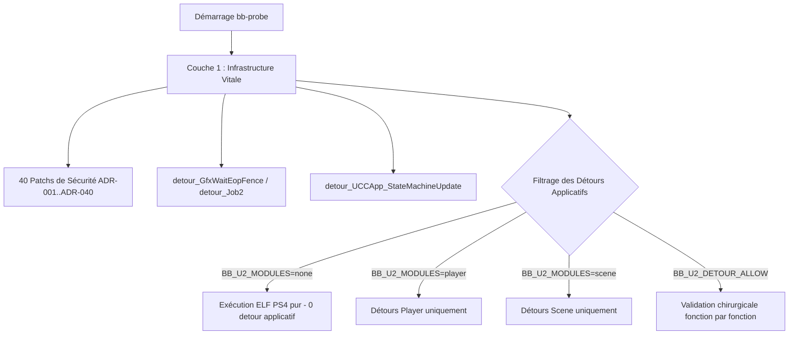

# Guide de Validation et d'Audit des Détours C Natifs (Uncharted 2 PC)

> Ce document définit la méthodologie officielle et l'architecture technique permettant de tester, valider et isoler les **930+ fonctions décompilées en C natif** (`src/runtime_u2_*.c`) exécutées conjointement avec l'ELF PS4 (`eboot.elf`).

---

## 1. Contexte & Problématique

Dans `uncharted_pc`, le binaire hôte (`bb-probe.exe`) combine deux moteurs d'exécution :
1. **Le code PS4 original** (`eboot.elf`) : tournant directement sur le CPU x86-64 hôte avec redirection des accès registres/mémoire.
2. **Le runtime C natif** (`src/runtime_u2_*.c`) : réimplémentations manuelles et décompilations par lots (Lots 1 à 25) couvrant plus de 930 fonctions réparties en 5 sous-systèmes (`player`, `npc`, `scene`, `event`, `audio`).

### Le Risque des Régressions Silencieuses
Lorsqu'un detour natif est activé, il remplace du code assembleur validé par Naughty Dog. Si une fonction native présente :
* Un décalage d'offset dans une structure interne Naughty Dog (DC / Component),
* Une divergence de convention d'appel (SysV ABI vs Microsoft x64, préservation des registres callee-saved `rbx`, `r12-r15`),
* Une valeur de retour non conforme ou un écrasement de `%rax` lors du saut `write_detour_jmp64`,
* Une boucle infinie ou un débordement de pile,

le moteur subit un crash ou un blocage en aval (écran noir, freeze d'image, désynchronisation des fibres).

---

## 2. Découplage Architectural : Infrastructure vs Modules Applicatifs

Pour tester les détours un à un, le système d'injection dans [`src/runtime_u2_script.c`](file:///c:/Users/Yohan/Desktop/uncharted_pc-0.3.3/src/runtime_u2_script.c) doit distinguer strictement deux catégories :



### Couche 1 : L'Infrastructure Vitale (Toujours Active)
Ne doit **jamais** être désactivée par un commutateur global :
* **State Machine & Boot** : `detour_UCCApp_StateMachineUpdate` (`0x00D59A50`), `detour_IntroState_Update` (`0x00A551B0`).
* **Synchronisation GPU / CPU** : `detour_GfxWaitEopFence` (`0x00B29F10`), `detour_Job2` (`0x003F68C0`), `hook_JobDispatch` (`0x00B3DB04`).
* **Gardes Mémoire et Allocateurs** : Patchs d'architecture ADR-001 à ADR-040 (FIOS2, PlayGo, EOP tick, audio caves, bounds checks).

### Couche 2 : Les Détours Applicatifs Modulaires (Testables un à un)
Les 930 fonctions regroupées par tables dans `s_module_getters` :
1. `u2_get_player_detours` (~100 fonctions : animations, stick, mouvements de Drake)
2. `u2_get_scene_detours` (~400 fonctions : caméras, splines, rails, streaming)
3. `u2_get_event_detours` (~150 fonctions : triggers, cutscenes, événements)
4. `u2_get_npc_detours` (~200 fonctions : comportement et physique des ennemis)
5. `u2_get_audio_detours` (~80 fonctions : filtres DSP, matrices audio)

---

## 3. Protocole de Validation en 4 Paliers

### Palier 0 : La Baseline "ELF Pur"
* **Objectif** : Vérifier que le moteur démarre, avance dans ses frames et initialise le rendu Vulkan sans **aucun** détour applicatif natif.
* **Configuration** : `BB_U2_MODULES=none`
* **Critère de succès** : Le cycle de boucle `AppMainLoop` tourne de manière stable sans interruption.

### Palier 1 : Validation Granulaire par Module
Activer un seul sous-système à la fois :
```powershell
# Test du module Player seul
$env:BB_U2_MODULES="player"
powershell -File scratch/run_test.ps1 10

# Test du module Scene seul
$env:BB_U2_MODULES="scene"
powershell -File scratch/run_test.ps1 10
```
* **Critère de succès** : Le jeu conserve la même stabilité que le Palier 0. Si un crash apparaît, le sous-système défaillant est identifié immédiatement.

### Palier 2 : Diagnostic par Dichotomie (Isolation Chirurgicale)
Lorsqu'un module provoque une anomalie :
1. Diviser les adresses virtuelles du module en deux moitiés (`0x00A00000 - 0x00B00000` et `0x00B00000 - 0x00D00000`).
2. Appliquer le filtre via `BB_U2_DETOUR_RANGE=min-max`.
3. Réduire l'intervalle par deux à chaque exécution.
4. En **moins de 8 essais**, la fonction exacte causant le conflit est isolée.

### Palier 3 : Traçage Télémétrique des Appels
Pour savoir exactement quelles fonctions C natives sont invoquées par le jeu au cours de la frame :
* Chaque entrée de detour peut journaliser son premier appel :
  ```c
  [Detour Hit] 0x00A14120: ExecuteScriptCode (caller=0x003F43BE)
  ```
* En cas d'exception, le journal indique précisément le dernier detour actif avant l'anomalie.

---

## 4. Checklist de Conformité d'une Fonction C Native

Avant de valider définitivement un detour :
- [ ] **Convention ABI** : Utilise le macro `ABI` (`__attribute__((sysv_abi))` ou équivalent) pour toute fonction appelée depuis l'ELF guest.
- [ ] **Préservation des Registres** : Les registres `rbx`, `rsp`, `rbp`, `r12`, `r13`, `r14`, `r15` doivent être strictement conservés conformément à la convention SysV.
- [ ] **Contrôle des Pointeurs NULL** : Tout pointeur d'instance (`this`) ou de ressource transmis par l'ELF doit être validé (`if (!ptr || (uintptr_t)ptr < 0x10000) return ...`).
- [ ] **Alignement Mémoire** : Tout accès SIMD/AVX (`vmovaps`) doit garantir un alignement de 16 ou 32 octets sous peine d'interruption matérielle.
- [ ] **Valeur de Retour** : S'assurer que le registre de retour (`rax` ou `xmm0`) correspond fidèlement au comportement attendu par le code assembleur original.

---

## 5. Commandes de Référence

```powershell
# Compilation propre MSYS2 CLANG64
powershell -ExecutionPolicy Bypass -File scratch/build_msys2.ps1

# Test standard (10s)
powershell -ExecutionPolicy Bypass -File scratch/run_test.ps1 10

# Audit de la base de mapping
node scratch/audit_detours.js

# Rapport d'avancement
node scratch/status_report.js
```

---

## 6. Journal des Jalons Validés

* **Milestone 205/843** (`34bfb38`) : 205 fonctions DC natives réécrites en C (`ABI`), couvrant audio, player et scene avec 0 crash runtime.
* **Milestone 200/843** (`aace663`) : 200 fonctions DC natives réécrites en C (`ABI`), compilées sous Clang64 et vérifiées en direct à l'amorçage avec 0 crash.
* **Baseline Initiale** (`e80b482`) : 172 fonctions DC natives. (+28 fonctions natives validées unitairement).
