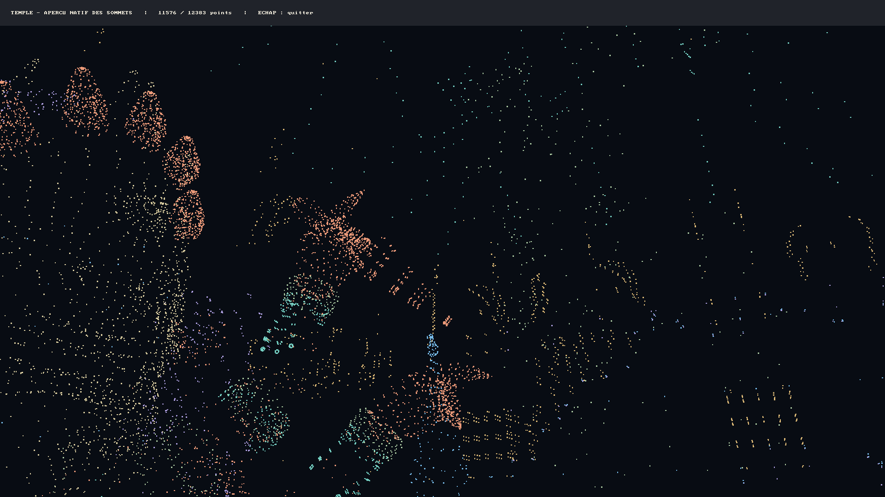
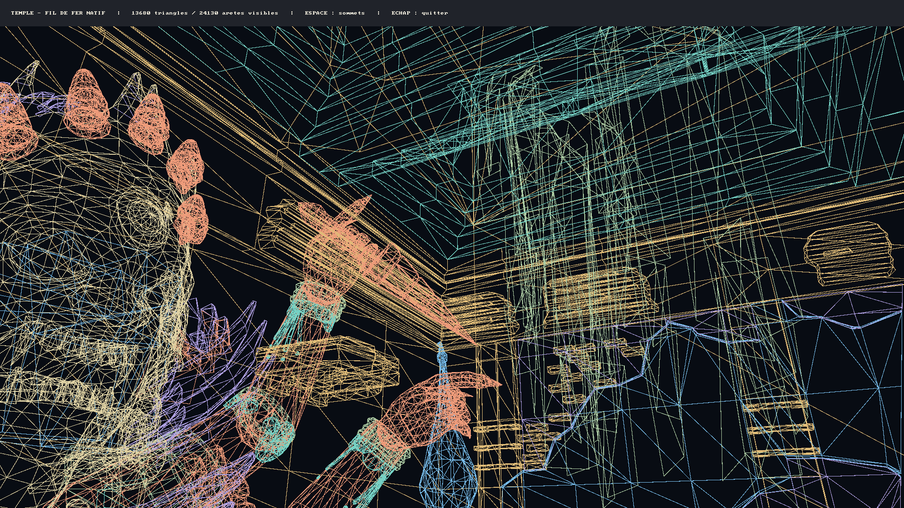
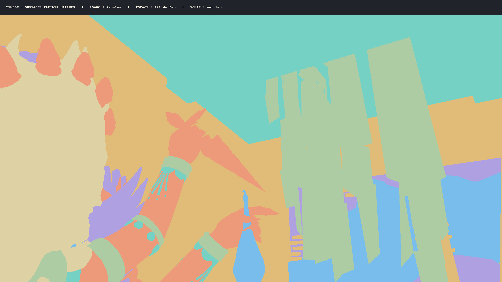
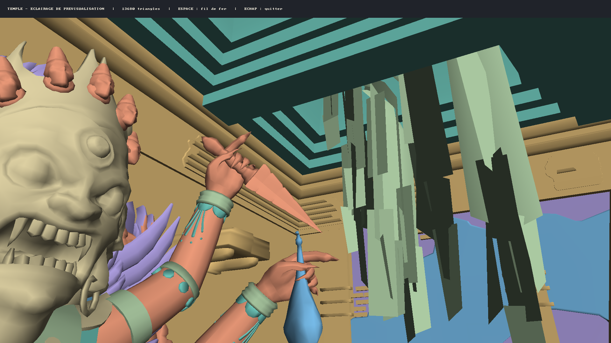
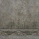

# Preuves d'avancement — Uncharted 2 natif

Dossier constitué le **12 novembre 2026**, fuseau Europe/Paris.

[Ouvrir le document HTML autonome](preuves_avancement/2026-11-12/preuves_avancement.html).
Les six images sont intégrées dans ce fichier HTML, consultable hors ligne.

## Première étape : vrais sommets du temple

Capture conservée du premier aperçu validé, associé au commit `8199a62`.
Treize sous-meshes issus de `menu-temple.pak` : **12 383 positions**, dont
**11 576 visibles** depuis la caméra de départ.

## Deuxième étape : triangles en fil de fer

Nouvelle capture réalisée pour ce dossier sur la version `5c6750f`.
**13 680 triangles réels**, **24 130 arêtes visibles**. Les buffers d'indices
des treize sous-meshes ont été retrouvés dans les dessins du moteur original,
avec des indices de 16 bits et une topologie TriangleList sans primitive restart.

## Troisième étape : surfaces pleines avec profondeur

Capture du rendu associé au commit `f25a5f9` : les **13 680 triangles** sont
remplis avec un test de profondeur par pixel. Les surfaces proches masquent
celles derrière elles. L'image statique est calculée sur CPU puis présentée
par SDL ; les couleurs distinguent les sous-meshes, sans matériaux ni éclairage.
Espace parcourt les vues surfaces pleines, fil de fer et sommets.

## Quatrième étape : relief éclairé depuis les normales

Capture du rendu associé au commit `f7447a3`. Les **12 383 normales** du PAK
pilotent un éclairage directionnel de prévisualisation : le visage de la statue,
les doigts, les bracelets et les moulures montrent désormais leur relief.
Les intensités sont interpolées avec correction de perspective.
Ce preset du viewer ne reproduit pas les lumières ou matériaux originaux ;
les textures et ombres portées ne sont pas encore présentes.

## Cinquième étape : première texture réelle décodée

La version `5273f81` décode le premier mip BC1 de la carte de couleur des
colonnes : **64 × 64, 4 096 pixels RGBA**. Ses 5 120 octets compressés, mipmaps
comprises, sont identiques à l'image GPU originale par SHA-256.
Le décodeur réordonne les blocs Thin1DThin et conserve les valeurs sRGB encodées.
Cette image est un asset décodé, pas une capture du menu texturé ; elle n'est
pas encore appliquée aux meshes. Aucune haute résolution n'est reconstruite.

## Sixième étape : pierre texturée dans le framebuffer natif

La carte de couleur réelle du matériau « colonnes » est désormais appliquée
au sous-mesh 21 : les corniches et surfaces de pierre autour de la statue
montrent leurs détails gris, avec UV corrigés en perspective et répétition.
Le trajet UV/image/sampler est établi dans les shaders originaux capturés.

Capture réelle SDL 1920×1080 du build basé sur `338d654` avec cette évolution,
identifié par SHA-256 dans `provenance.json`. Validation : natif **469/469**,
sortie **0** après six secondes ; hybride **475/475**, timeout attendu de
**30 secondes**, SelfTest et sandbox réussis. Aucun crash ni nouvelle assertion.

Limites : un seul mesh, premier mip résident **64×64**, filtre bilinéaire sans
anisotropie ni sélection LOD. L'éclairage reste celui du viewer et le matériau
original complet n'est pas reproduit. Les autres surfaces restent colorées.
Voir [preuves et méthode](NATIVE_TEMPLE_COLOR_SAMPLING.md).

## Validation et provenance

| Contrôle | Résultat | Scénario |
| --- | --- | --- |
| Capture des surfaces pleines | 319/319 assertions, sortie 0 | Délai de 8 secondes atteint |
| Hybride au jalon surfaces pleines | 325/325 assertions, sans faute signalée | Timeout de 6 secondes |
| Stabilité des trois vues | 319/319 assertions, sortie 0 | 25 secondes, plusieurs cycles avec Espace |
| Capture éclairée | 349/349 assertions, sortie 0 | Délai de 8 secondes atteint |
| Validation hybride après éclairage | 355/355 assertions, sans faute signalée | Timeout de 6 secondes |
| Décodage BC1 natif | 414/414 assertions, sortie 0 | 6 secondes, dont le vrai bloc des colonnes |
| Validation hybride après BC1 | 420/420 assertions, sans faute signalée | Timeout de 6 secondes |

Les quatre premières images sont des captures réelles du framebuffer de
`uncharted2-native.exe`, en 1920 × 1080. La cinquième est une texture 64 × 64
produite par le décodeur C++ testé et inspectée visuellement.
La sixième est une nouvelle capture réelle du framebuffer, avec la première
carte de couleur appliquée à la géométrie.
La conversion BMP vers PNG ne comporte aucune retouche.

- [Journal de la nouvelle capture](preuves_avancement/2026-11-12/validation-native.txt).
- [Journal des surfaces pleines et des trois modes](preuves_avancement/2026-11-12/validation-surfaces.txt).
- [Journal de la capture éclairée](preuves_avancement/2026-11-12/validation-eclairage.txt).
- [Journal natif du décodage BC1](preuves_avancement/2026-11-12/validation-bc1.txt).
- [Comparaisons des octets compressés aux images GPU originales](preuves_avancement/2026-11-12/bc1-gpu-matches.json).
- [Empreintes SHA-256 des images et de l'exécutable capturé](preuves_avancement/2026-11-12/provenance.json).
- [Preuves du nuage de points](NATIVE_TEMPLE_POINT_PREVIEW.md).
- [Validation des indices dans l'original](NATIVE_TEMPLE_TRIANGLE_INDICES.md).
- [Preuves du fil de fer et du clipping](NATIVE_TEMPLE_WIREFRAME.md).
- [Preuves des surfaces pleines et limites du viewer](NATIVE_TEMPLE_SOLID_PREVIEW.md).
- [Normales réelles du temple](NATIVE_TEMPLE_NORMALS.md).
- [Calcul et validation de l'éclairage de prévisualisation](NATIVE_TEMPLE_LIGHTING.md).
- [Décodage des pixels BC1 et limites](NATIVE_TEMPLE_BC1_PIXELS.md).
- [Chargement des 60 images résidentes par métadonnées](NATIVE_TEXTURE_TABLE_LOADING.md).
- [Liaison des 100 références de matériaux aux images](NATIVE_MATERIAL_IMAGE_BINDINGS.md).
- [Échantillonnage de la carte de couleur et trajet shader vérifié](NATIVE_TEMPLE_COLOR_SAMPLING.md).

Le pipeline GPU du jeu, les textures des autres surfaces, l'éclairage original
et les interactions du menu restent à porter. Hors du sous-mesh de pierre
texturé, les couleurs servent à distinguer les sous-meshes. Cet aperçu emploie la caméra
de départ et une lentille de référence capturée ; son affichage n'exécute aucun
octet de code PS4.
