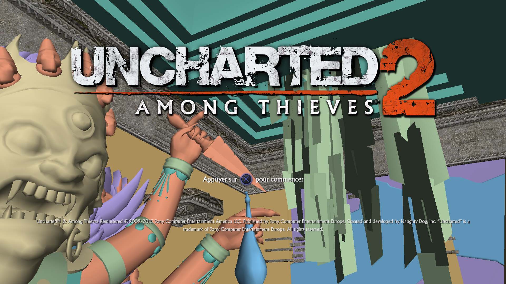
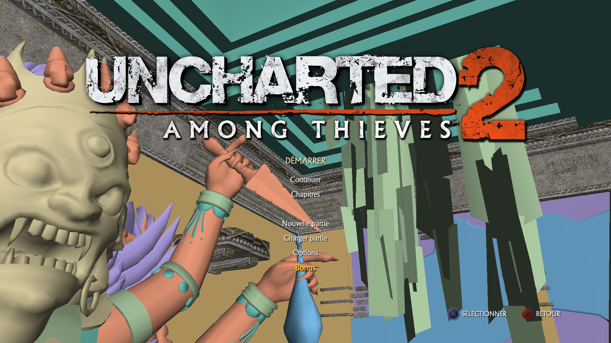
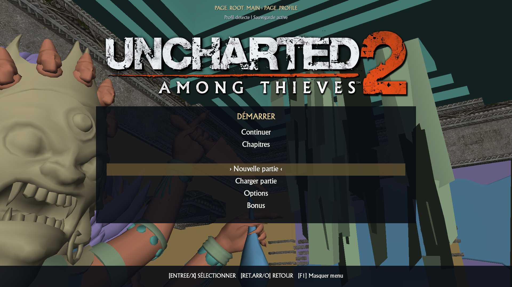
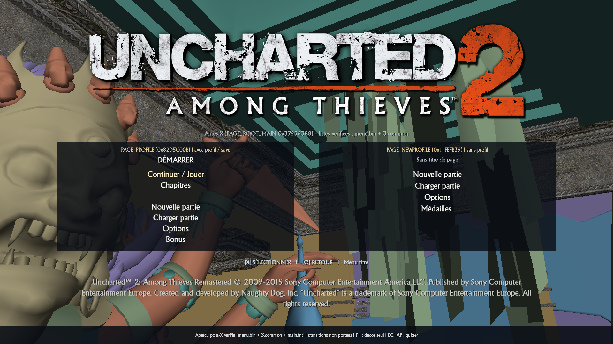
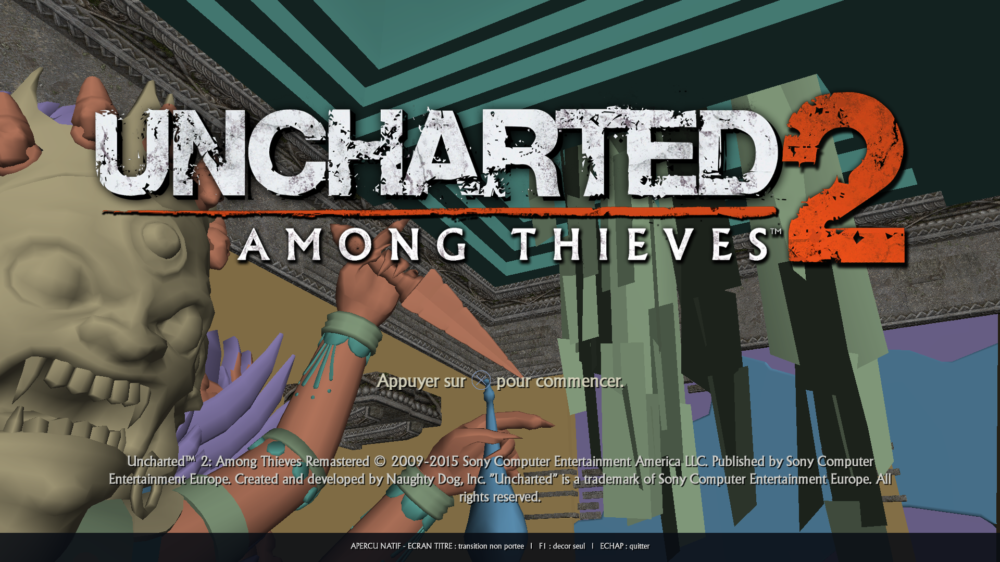
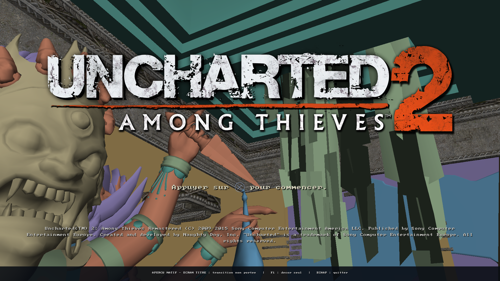
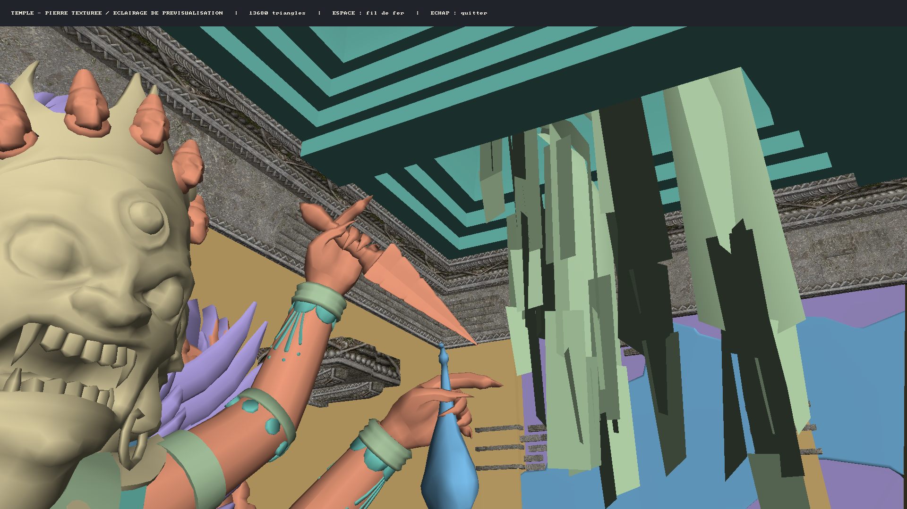

# Preuves d'avancement — Uncharted 2 natif

Historique des **12, 13 et 14 novembre 2026**, fuseau Europe/Paris.

[Ouvrir le document HTML autonome](preuves_avancement/2026-11-12/preuves_avancement.html).
Les sept images sont intégrées dans ce fichier HTML, consultable hors ligne.

## 14 novembre (Chantier A3) : constantes exactes `MenuDrawer::DrawBox`, titre `1.25×` blanc pur et ombres `eboot.elf`

[Galerie autonome Chantiers A2 &amp; A3](preuves_avancement/2026-11-14/preuves_avancement.html) (**4** captures framebuffer 1920×1080 embarquées).

Remplacement des approximations du viewer par les constantes extraites de `out/big2/eboot.elf` :
- **Panneau `MenuDrawer::DrawBox`** (`0x005B8710`, `0x00E61D18–0x00E61D54`) : rendu `SDL_RenderGeometry` noir pur `(0, 0, 0)` avec fondu haut `24.0f`, corps alpha `0.65f`, fondu bas `40.0f` et suppression de la bordure rectangle beige.
- **Titre & Copyright** (`0x005A4B3F`, `0x005A4250`) : titre blanc pur `(255, 255, 255, 255)` à l'échelle `1.25×`, copyright échelle `0.65f` ancré à `bottom = 642.0f` (720p).
- **Ombres portées** (`0x0059DA46`, `0x0057A9B7`) : `shadow_offset = 3.0f` (`4.0f` sur contrôles) et `shadow_alpha = 1.0f`.

Validation (build basé sur `d8f9b35`, `out/uncharted2-native.exe` SHA-256 `a0533eb5...`) :
- Natif `scratch/run_native_test.ps1 6` : **653/653** assertions C++23 (`EngineTest`), code de sortie **0**.
- Hybride `scratch/run_test.ps1 6` (`bb-probe.exe`, `user/last_run.log`) : SelfTest **886**, full-body **831**, EngineTest **659/659**, `STOPPED_AFTER_TIMEOUT` sans crash ni Guest fault.

## 14 novembre (Chantier A2) : géométrie `1280×720` `MenuPage`, masquage du logo hors titre et panneau `DrawBox`

[Galerie autonome Chantier A2](preuves_avancement/2026-11-14/preuves_avancement.html) (**2** captures framebuffer 1920×1080 embarquées).

Le calcul de géométrie `u2_native_ComputeMenuPageLayout` (`src/u2_engine/ndlib/render/ngen/menu_preview.{h,cpp}`) et le rendu dans `src/u2_standalone/title_preview.h` appliquent les règles extraites de `out/big2/eboot.elf` :
- **Repère virtuel `1280.0f × 720.0f`** (`MenuHost::Draw` `0x005D130D–0x005D1370`) mis à l'échelle vers la sortie (`1920×1080`).
- **Visibilité du logo** (`MenuPage::DrawSinglePage` `0x005A611E` & `MenuDrawer::BuildIcon` `0x005BC6B6`) : `general/menu/menu-logo` (`1024×256` en `(128, 25)` 720p) n'est affiché que sur `PAGE_ROOT_MAIN` (`0x37656388`), et masqué sur `PAGE_PROFILE` et ses sous-pages.
- **Panneau centré `MenuDrawer::DrawBox`** (`0x005A2670`, `0x005A6341`, `0x005B8710`) : lorsque `(page_flags & 0x81000) == 0` hors écran-titre, la boîte sombre semi-transparente est centrée dans `1280×720` avec bandeau de titre de `50.0f` et séparateur, et les invites `|X|` / `|C|` (`MenuPage::DrawPrompts` `0x005A50F2`) sont ancrées juste sous le bord inférieur droit du panneau (`prompts_y = page_box_rect.y + page_box_rect.h + 15.0f`).

Validation (build basé sur `395a205`, `out/uncharted2-native.exe` SHA-256 `fb1f6feb...`) :
- Natif `scratch/run_native_test.ps1 6` : **650/650** assertions C++23 (`EngineTest`), code de sortie **0**.
- Hybride `scratch/run_test.ps1 6` (`bb-probe.exe`, `user/last_run.log`) : SelfTest **886**, full-body **831**, EngineTest **656/656**, `STOPPED_AFTER_TIMEOUT` sans crash ni Guest fault.
- Captures SDL 1920×1080 inspectées visuellement (`native-menu-root.png` SHA-256 `b82b0b8a...` ; `native-menu-profile.png` SHA-256 `80224a8c...`).

## 14 novembre (Chantier A) : habillage fidèle `MenuDrawer` et icônes `symbol3.fnt`

[Galerie autonome mise à jour](preuves_avancement/2026-11-13/preuves_avancement.html)
(référence hybride, premier aperçu natif, `main.fnt`, listes post-X, machine à états live, écran-titre épuré et `PAGE_PROFILE` fidèle avec `symbol3.fnt` — **7** images embarquées).

L'analyse binaire de `out/big2/eboot.elf` et des assets d'interface achève le retrait de l'habillage de diagnostic dans le viewer natif :
- Décodage natif de la police d'icônes PlayStation `u2data/data/fonts/ps4/symbol3.fnt` + `symbol3_00.tga` (slot 2 de `g_apFonts` `0x0144E640` chargé en `0x003F6E81`, **32** glyphes `chnl=15` `packed=0`, TGA 512×512 BGRA32 origine bas-gauche `tga[17]=0x08`) via `src/u2_engine/ndlib/render/ngen/font_preview.{h,cpp}` et `src/u2_standalone/bitmap_font_preview.h`.
- Substitution des balises `|ENTER|` / `|X|` (glyphe `5`, Croix bleue), `|C|` / `|BACK|` (glyphe `2`, Rond rouge), `|S|` (`3`) et `|T|` (`4`) prouvée dans `Font::DrawText` (`0x00CCB270–0x00CCB450`).
- Décodage dans `menu_preview.{h,cpp}` des champs `+0x20/+0x28` (`MENU_LEGAL_COPYRIGHT` `0xC313D6F2` sur `PAGE_ROOT_MAIN`), `+0x34` (`page_flags` bit `0x1` testé en `0x005A4F75` pour masquer les invites standard) et `+0x40/+0x44` (`layout_x`, `layout_y`).
- Rendu `MenuDrawer` dans `src/u2_standalone/title_preview.h` sans panneau noir, ni bandeau bas, ni fil d'Ariane, ni chevrons `> <`, ni encadré doré : `PAGE_ROOT_MAIN` affiche le logo, `"Appuyer sur [Croix bleue] pour commencer"` et les mentions légales enveloppées ; les sous-pages flottent avec ombres portées, sélection dorée (`240, 200, 40`) et invites `|X| SÉLECTIONNER` / `|C| RETOUR` en bas à droite.

Validation (build basé sur `23bba9a`, `out/uncharted2-native.exe` SHA-256 `70ccfffb...`) :
- Natif `scratch/run_native_test.ps1 6` : **643/643** assertions C++23 (dont Étape 21), full-body **831**, code **0**.
- Hybride `scratch/run_test.ps1 6` (`bb-probe.exe`, `user/last_run.log`) : SelfTest **886**, full-body **831**, EngineTest **649/649**, `STOPPED_AFTER_TIMEOUT` sans crash ni Guest fault.
- Captures SDL 1920×1080 inspectées visuellement (`04-menu-fidele-ecran-titre-symbol3.png` `1 940 310` o SHA-256 `12474b47...` avec `BB_NATIVE_CAPTURE_PAGE=ROOT` ; `05-menu-fidele-page-profil-symbol3.png` `1 918 767` o SHA-256 `d19d5dbd...` avec `BB_NATIVE_CAPTURE_PAGE=PROFILE`, où `Bonus` est doré par survol pointeur initial sur l'écran secondaire). Voir [preuves et limites](NATIVE_TITLE_SCREEN_PREVIEW.md).

## 14 novembre : machine à états interactive `MenuHost` (pile de pages, sauvegardes `SAVEDATA` et navigation live)

[Galerie autonome précédente](preuves_avancement/2026-11-13/preuves_avancement.html)
(machine à états live interactive ajoutée).

La machine à états hôte `U2NativeMenuStateMachine` (`src/u2_engine/ndlib/render/ngen/menu_preview.{h,cpp}`)
reproduit le modèle `MenuHost` de `out/big2/eboot.elf` (`0x005CB990 TransitionToPage`,
`0x005C88CE` Sélection, `0x005C8D90` Retour) sur les pages vérifiées de
`dc1/ps4/menu.bin` et `core.psarc:text1/ps4/3.common` :
- Détection de présence profil et campagne sur `SAVEDATA02P/USR-DATA` et
  `SAVEDATA020/USR-DATA` (somme des octets `0xCD..0xD6` inclus, orientant
  `PAGE_ROOT_MAIN` `0x37656388` vers `PAGE_PROFILE` `0x82D5C00B` vs
  `PAGE_NEWPROFILE` `0x11FEFB39` et résolvant `BUTTON_CONTINUE` `0x161522F1`
  entre `"Continuer"` et `"Jouer"`).
- Décodage des cibles de navigation (`+0x48` `target_page_name`, `+0x50`
  `target_page_id`) et chargement des sous-pages `PAGE_INGAME_OPTIONS`
  (`0xB793B4B2`), `PAGE_BONUSES` (`0x22D667C0`), `PAGE_CHAPTERS` (`0xBE2C8B4B`)
  et `PAGE_MULTIMEDALS` (`0xACE1A9D5`).
- Pile de pages avec conservation du curseur par page et saut automatique des
  séparateurs et éléments non `type == 2` (`Entrée`/`X`/`Espace`, flèches/`ZQS`D,
  `Retour arrière`/`Échap`, survol/clic souris et bascule `F1`). Les actions
  gameplay (`Nouvelle partie`, `Charger partie`, `Continuer / Jouer`, `Options
  de jeu`, `Commencer chapitre`) et les feuilles/listes dynamiques non portées
  (`PAGE_CONTROLS`, `LIST_MEDALS`, etc.) restent explicitement différées sans
  simulation. Disposition du panneau, fil d'Ariane, couleurs et bandeau de
  surbrillance restent des conventions du viewer.

Validation (build basé sur `01ddd0a`, `out/uncharted2-native.exe` SHA-256
`967d194e...`) : natif **606/606** (dont Étape 20), sortie **0** après six
secondes ; séquence interactive automatisée Win32 (`Entrée` -> `PAGE_PROFILE`,
`Bas`×2 -> `cursor=3` « Nouvelle partie » en sautant le séparateur 2, capture
réelle `>= 1800 ms`, puis `Options` -> `PAGE_INGAME_OPTIONS` -> `Retour` ->
`F1` `hidden`/`visible`), sortie **0** ; hybride `scratch/run_test.ps1 6`
(`bb-probe.exe`, `user/last_run.log`) **612/612**, SelfTest **886**, full-body
**831**, zéro crash ni Guest fault jusqu'à `STOPPED_AFTER_TIMEOUT`. Capture SDL
1920×1080 inspectée visuellement (PNG `1 453 587` octets, SHA-256 `24376828...`).
Voir [preuves et limites](NATIVE_TITLE_SCREEN_PREVIEW.md).

## 14 novembre : listes du menu après X vérifiées dans `menu.bin` + `core.psarc:3.common`

[Galerie autonome mise à jour](preuves_avancement/2026-11-13/preuves_avancement.html)
(référence hybride, premier aperçu natif, capture `main.fnt` et listes post-X intégrés — 4 images embarquées).

L'analyse binaire de `out/big2/eboot.elf` (`0x005CB5B7` sur `PAGE_ROOT_MAIN`
`0x37656388` / `BUTTON_TITLE_START` `0x2BBBB5C5`, puis transition
`0x005C8DAB` -> `0x005CB990`) établit la bifurcation post-X vers deux pages de
`dc1/ps4/menu.bin` : **`PAGE_PROFILE`** (`0x82D5C00B` en `0x005CB851` si
profil/sauvegarde présent, titre `DÉMARRER` `0x317D0541`, **7** contrôles dont
un séparateur à l'index 2 et la source dynamique `16/0` `0x005ACAB0`
`Continuer / Jouer`) et **`PAGE_NEWPROFILE`** (`0x11FEFB39` en `0x005CB807` sans
profil, **4** contrôles dont `Médailles `). Toutes les chaînes françaises et de
navigation (`[X] SÉLECTIONNER`, `[O] RETOUR`, `Menu titre`) sont lues depuis
`core.psarc:text1/ps4/3.common` (entrée 46 à `0x410000`, `87 097` octets en
blocs bruts `[0, 21561]`) et rendues avec `main.fnt` via
`src/u2_engine/ndlib/render/ngen/menu_preview.{h,cpp}` et
`src/u2_standalone/title_preview.h`. La disposition en deux cartes, les couleurs
et l'affichage statique sans transitions restent des conventions du viewer.

Validation (build basé sur `deda6fc`, `out/uncharted2-native.exe` SHA-256
`f840127d...`) : natif **552/552** (dont Étape 19), sortie **0** après six
secondes ; basculement `F1` (`hidden` / `visible`) validé, sortie **0** ; hybride
**558/558**, SelfTest **886**, full-body **831**, `77 824` copies scalaires GPU,
zéro crash ni Guest fault jusqu'à fermeture manuelle de la fenêtre au-delà de
30 s (`user/last_run.log`). Capture SDL 1920×1080 inspectée visuellement (PNG
`1 698 838` octets, SHA-256 `f28b58aa...`). Voir
[preuves et limites](NATIVE_TITLE_SCREEN_PREVIEW.md).

## 14 novembre : police réelle `main.fnt` prouvée dans `eboot.elf` et rendue sur l'écran-titre natif

[Galerie autonome mise à jour](preuves_avancement/2026-11-13/preuves_avancement.html)
(référence hybride, premier aperçu natif et capture `main.fnt` intégrés).

L'analyse binaire de `out/big2/eboot.elf` prouve que le menu utilise réellement
`main.fnt` (`Adelon-Serial DB`, **183** glyphes, **592** paires de crénage,
atlas `main_00.tga` 256×128 packé sur 4 plans B/G/R/A, chargée en slot 1 de
`g_apFonts` `0x0144E640` par `0x003F68C0`). `game3.fnt` (`0x003FE000`) n'est
lié qu'à la commande debug `reloadfont` (`0` appelant direct, texture absente).
Le texte UTF-8 (`™`, `©`, invitation française et barre d'état) est désormais
rendu par cet atlas réel dans `title_preview.h`, tandis que le placement, l'icône
croix géométrique (`symbol3.fnt` réservé aux codes ≤ 14), l'ombre et l'inversion
verticale du logo restent des conventions du viewer.

Validation (build basé sur `bdda25c`, `out/uncharted2-native.exe` SHA-256
`03baee31...`) : natif **501/501**, sortie **0** après six secondes ; basculement
`F1` (`hidden` / `visible`) validé, sortie **0** ; hybride **507/507**, SelfTest
**886**, sandbox **831**, zéro crash ni Guest fault jusqu'à fermeture manuelle
de la fenêtre au-delà de 30 s (`user/last_run.log`). Capture SDL 1920×1080
inspectée visuellement (PNG SHA-256 `d307c00b...`). Voir
[preuves et limites](NATIVE_TITLE_SCREEN_PREVIEW.md).

## 13 novembre : premier écran-titre sur le temple natif

[Galerie autonome du 13 novembre](preuves_avancement/2026-11-13/preuves_avancement.html),
avec référence hybride conservée et capture native.

Le logo réel **2048×512**, couleur BC1 et masque BC4, est décodé depuis
`menu.pak` après comparaison des deux chaînes aux images GPU originales.
L'invitation française et les mentions relevées apparaissent sur le temple.
Disposition et police restent provisoires ; l'invitation est statique et la
transition vers les options n'est pas portée. F1 permet de retrouver le décor seul.

Validation : natif **493/493**, sortie **0** après six secondes ; hybride
**499/499**, SelfTest et sandbox réussis, timeout attendu de **30 secondes**.
Test F1 de douze secondes réussi. Aucun crash ni nouvelle assertion.
Capture réelle SDL 1920×1080 du build basé sur `ad88d7b` avec cette évolution ;
empreinte dans la provenance. Voir [preuves et limites](NATIVE_TITLE_SCREEN_PREVIEW.md).

## Première étape : vrais sommets du temple

Capture conservée du premier aperçu validé, associé au commit `8199a62`.
Treize sous-meshes issus de `menu-temple.pak` : **12 383 positions**, dont
**11 576 visibles** depuis la caméra de départ.

## Deuxième étape : triangles en fil de fer

Nouvelle capture réalisée pour ce dossier sur la version `5c6750f`.
**13 680 triangles réels**, **24 130 arêtes visibles**. Les buffers d'indices
des treize sous-meshes ont été retrouvés dans les dessins du moteur original,
avec des indices de 16 bits et une topologie TriangleList sans primitive restart.

## Troisième étape : surfaces pleines avec profondeur

Capture du rendu associé au commit `f25a5f9` : les **13 680 triangles** sont
remplis avec un test de profondeur par pixel. Les surfaces proches masquent
celles derrière elles. L'image statique est calculée sur CPU puis présentée
par SDL ; les couleurs distinguent les sous-meshes, sans matériaux ni éclairage.
Espace parcourt les vues surfaces pleines, fil de fer et sommets.

## Quatrième étape : relief éclairé depuis les normales

Capture du rendu associé au commit `f7447a3`. Les **12 383 normales** du PAK
pilotent un éclairage directionnel de prévisualisation : le visage de la statue,
les doigts, les bracelets et les moulures montrent désormais leur relief.
Les intensités sont interpolées avec correction de perspective.
Ce preset du viewer ne reproduit pas les lumières ou matériaux originaux ;
les textures et ombres portées ne sont pas encore présentes.

## Cinquième étape : première texture réelle décodée

La version `5273f81` décode le premier mip BC1 de la carte de couleur des
colonnes : **64 × 64, 4 096 pixels RGBA**. Ses 5 120 octets compressés, mipmaps
comprises, sont identiques à l'image GPU originale par SHA-256.
Le décodeur réordonne les blocs Thin1DThin et conserve les valeurs sRGB encodées.
Cette image est un asset décodé, pas une capture du menu texturé ; elle n'est
pas encore appliquée aux meshes. Aucune haute résolution n'est reconstruite.

## Sixième étape : pierre texturée dans le framebuffer natif

La carte de couleur réelle du matériau « colonnes » est désormais appliquée
au sous-mesh 21 : les corniches et surfaces de pierre autour de la statue
montrent leurs détails gris, avec UV corrigés en perspective et répétition.
Le trajet UV/image/sampler est établi dans les shaders originaux capturés.

Capture réelle SDL 1920×1080 du build basé sur `338d654` avec cette évolution,
identifié par SHA-256 dans `provenance.json`. Validation : natif **469/469**,
sortie **0** après six secondes ; hybride **475/475**, timeout attendu de
**30 secondes**, SelfTest et sandbox réussis. Aucun crash ni nouvelle assertion.

Limites : un seul mesh, premier mip résident **64×64**, filtre bilinéaire sans
anisotropie ni sélection LOD. L'éclairage reste celui du viewer et le matériau
original complet n'est pas reproduit. Les autres surfaces restent colorées.
Voir [preuves et méthode](NATIVE_TEMPLE_COLOR_SAMPLING.md).

## Septième étape : vraie texture de pierre 1024×1024

La même carte de couleur existe dans `chunk-21-tstrm.pak` en **1024×1024**.
Sa chaîne BC1 complète a été comparée octet pour octet à une image GPU
originale. Le viewer charge cette seule ressource et retrouve les détails
des moulures et du grain de pierre, sans agrandissement du 64×64.

Capture réelle 1920×1080 du build basé sur `30aff7a` avec cette évolution,
identifié par SHA-256 dans `provenance.json`. Natif **484/484**, sortie **0**
après six secondes ; hybride **490/490**, timeout attendu de **30 secondes**.
SelfTest et sandbox réussis, aucun crash ni nouvelle assertion.

Le chargement est ponctuel et ciblé sur le même sous-mesh ; la politique de
streaming originale n'est pas portée. Le filtrage reste bilinéaire au premier
mip, sans choix LOD ni anisotropie. Voir [preuves et limites](NATIVE_TEMPLE_DETAILED_COLOR.md).

## Validation et provenance

| Contrôle | Résultat | Scénario |
| --- | --- | --- |
| Capture des surfaces pleines | 319/319 assertions, sortie 0 | Délai de 8 secondes atteint |
| Hybride au jalon surfaces pleines | 325/325 assertions, sans faute signalée | Timeout de 6 secondes |
| Stabilité des trois vues | 319/319 assertions, sortie 0 | 25 secondes, plusieurs cycles avec Espace |
| Capture éclairée | 349/349 assertions, sortie 0 | Délai de 8 secondes atteint |
| Validation hybride après éclairage | 355/355 assertions, sans faute signalée | Timeout de 6 secondes |
| Décodage BC1 natif | 414/414 assertions, sortie 0 | 6 secondes, dont le vrai bloc des colonnes |
| Validation hybride après BC1 | 420/420 assertions, sans faute signalée | Timeout de 6 secondes |

Les quatre premières images sont des captures réelles du framebuffer de
`uncharted2-native.exe`, en 1920 × 1080. La cinquième est une texture 64 × 64
produite par le décodeur C++ testé et inspectée visuellement.
La sixième est une nouvelle capture réelle du framebuffer, avec la première
carte de couleur appliquée à la géométrie.
La septième montre cette même surface avec sa carte originale 1024×1024.
La conversion BMP vers PNG ne comporte aucune retouche.

- [Journal de la nouvelle capture](preuves_avancement/2026-11-12/validation-native.txt).
- [Journal des surfaces pleines et des trois modes](preuves_avancement/2026-11-12/validation-surfaces.txt).
- [Journal de la capture éclairée](preuves_avancement/2026-11-12/validation-eclairage.txt).
- [Journal natif du décodage BC1](preuves_avancement/2026-11-12/validation-bc1.txt).
- [Comparaisons des octets compressés aux images GPU originales](preuves_avancement/2026-11-12/bc1-gpu-matches.json).
- [Empreintes SHA-256 des images et de l'exécutable capturé](preuves_avancement/2026-11-12/provenance.json).
- [Preuves du nuage de points](NATIVE_TEMPLE_POINT_PREVIEW.md).
- [Validation des indices dans l'original](NATIVE_TEMPLE_TRIANGLE_INDICES.md).
- [Preuves du fil de fer et du clipping](NATIVE_TEMPLE_WIREFRAME.md).
- [Preuves des surfaces pleines et limites du viewer](NATIVE_TEMPLE_SOLID_PREVIEW.md).
- [Normales réelles du temple](NATIVE_TEMPLE_NORMALS.md).
- [Calcul et validation de l'éclairage de prévisualisation](NATIVE_TEMPLE_LIGHTING.md).
- [Décodage des pixels BC1 et limites](NATIVE_TEMPLE_BC1_PIXELS.md).
- [Chargement des 60 images résidentes par métadonnées](NATIVE_TEXTURE_TABLE_LOADING.md).
- [Liaison des 100 références de matériaux aux images](NATIVE_MATERIAL_IMAGE_BINDINGS.md).
- [Échantillonnage de la carte de couleur et trajet shader vérifié](NATIVE_TEMPLE_COLOR_SAMPLING.md).
- [Carte détaillée 1024×1024 et comparaison à l'image GPU originale](NATIVE_TEMPLE_DETAILED_COLOR.md).

Le pipeline GPU du jeu, les textures des autres surfaces, l'éclairage original
et les interactions du menu restent à porter. Hors du sous-mesh de pierre
texturé, les couleurs servent à distinguer les sous-meshes. Cet aperçu emploie la caméra
de départ et une lentille de référence capturée ; son affichage n'exécute aucun
octet de code PS4.
