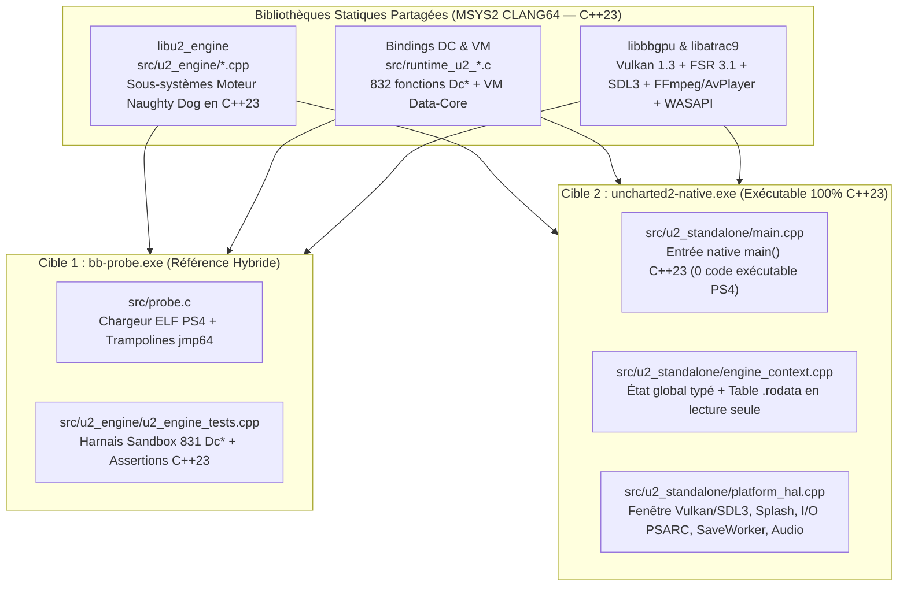

# Architecture & Plan d'Implémentation — `uncharted2-native.exe` (100 % C++23)

> **Branche dédiée** : `dev-native` (clonée depuis `dev` à l'état `3d5dded` avec 889 détours validés).
> **Objectif** : Construire un exécutable PC autonome (**`uncharted2-native.exe`**) contenant **exclusivement du code C++23 natif réécrit** (`src/u2_engine/`, `src/u2_standalone/`) et les couches d'abstraction matérielle PC (Vulkan, SDL3, WASAPI, ATRAC9, AvPlayer), sans exécuter le moindre octet de code machine PS4 (`eboot.elf`).

> Les étapes historiques marquées « COMPLÉTÉ » ci-dessous décrivent des
> prototypes ; elles ne prouvent pas une réimplémentation fidèle du boot ou
> du menu. La référence hybride a été restaurée et validée visuellement.
> Le standalone progresse encore dans le décodage et le login des ressources.

---

## 1. Vue d'Ensemble & Découplage CMake

Afin de conserver la capacité de comparer à tout instant le comportement du moteur natif C++23 avec la référence hybride (`bb-probe.exe`), le système de build ([`gpu/CMakeLists.txt`](file:///c:/Users/Yohan/Desktop/uncharted_pc-0.3.3/gpu/CMakeLists.txt)) est structuré en **deux exécutables distincts** partageant le même cœur C++23 :

### Garanties d'Isolation de `uncharted2-native.exe`

Le registre distingue désormais 55 méthodes hybrides validées et 25 prototypes
standalone. Ces derniers restent testés via trampolines de sandbox ; seuls
les builds `U2_STANDALONE` les installent en production. Cela inclut mémoire,
boot et les résolveurs DC privés : ils ne doivent pas remplacer les contrats
de durée de vie et d'initialisation de l'ELF hybride.

La famille AllocStack hôte est enregistrée uniquement pour cette cible
(`U2_STANDALONE=1`), avec un TLS C++ indépendant. Dans `bb-probe`, les huit
routines correspondantes restent à l'ELF ; les autotests mémoire utilisent
leurs propres trampolines de sandbox. Cette correction ne valide pas les
autres réécritures de boot partagées (voir `HYBRID_REGRESSION_ALLOCSTACK.md`).
1. **Zéro Exécution de Code Machine PS4** : Contrairement à `bb-probe.exe`, `uncharted2-native.exe` ne mappe **aucune page mémoire avec `PAGE_EXECUTE_READ` ou `PAGE_EXECUTE_READWRITE` provenant de `eboot.elf`**.
2. **Séparation Code / Données Statiques (`.rodata`)** :
   * Tant que certaines tables de constantes (hashes `StringId`, constantes mathématiques SIMD, tables de configuration de niveaux) sont référencées par leur offset, `uncharted2-native.exe` peut charger uniquement le segment de données en **lecture seule (`PAGE_READONLY`)** dans un tampon non exécutable, tandis que toute tentative de saut vers une adresse `.text` PS4 déclenche immédiatement une erreur explicite permettant d'identifier la fonction C++23 manquante.

---

## 2. Anatomie du Démarrage d'Uncharted 2 (Chaîne d'Amorçage Réelle)

L'analyse par désassemblage de `eboot.elf` établit la séquence exacte exécutée au lancement du jeu jusqu'au Menu Principal :

| Ordre | Offset ELF | Symbole / Fichier Source Original | Rôle dans le Démarrage |
| :--- | :--- | :--- | :--- |
| **1** | `0x000000A0` | `_start` | Point d'entrée bas niveau, initialise la CRT et appelle `main` (`0x005756A0`). |
| **2** | `0x005756A0` | `main` / `RegisterSysModuleConfig` (`memory-ps4.cpp`) | Enregistre la configuration `"single-player"` (`0x0118E2C0`, table `0x0105E220`) et configure `g_pMemoryMap` (`0x01569098` -> `0x01056AC0`). |
| **3** | `0x00576369` | `Memory::InitHeaps` (`0x00B33F80`) | Alloue les tas mémoire principaux du moteur (`SinglePlayer` heaps). |
| **4** | `0x005763B9` | `AllocateAllocStack` (`0x00B36D40`) & `PushAllocator` | Initialise la pile d'allocateurs TLS du thread principal (`m_allocatorStackSize`, profondeur max `0x2E`). |
| **5** | `0x00576726` | `JobSystem::Init` (`0x00B271E0`) | Initialise les pools de jobs et fibres (`0x800`, `0x400`, `0x300000`). |
| **6** | `0x00576738` | `App::ParseArgs` (`0x003F2700`) | Analyse les arguments de ligne de commande (`argc`, `argv`). |
| **7** | `0x0057673D` | `App::Init` (`0x003F41B0`) | Initialise FIOS2/PlayGo, monte `bin.psarc` et `actor97.psarc` (`GameLoadingMountInitialArchives` `0x00B783F0`), lance `DCLoader` et `SaveWorker` (`SAVEDATA020`, `SAVEDATA02P`, `SAVEDATA0CC`). |
| **8** | `0x0057674D` | `App::RunMainLoop` (`0x003F4AA0`) | Lance la fibre principale (`0x003FA9F0`) qui cadencera la boucle de rendu et de mise à jour à 60 Hz. |
| **9** | `0x00D59A50` | `UCCApp::StateMachineUpdate` (`streaming.cpp` / `uccapp.cpp`) | Machine à états centrale (états `1` à `11`) : attente FIOS2, masquage du splash screen, lancement de `IntroState::Update` (`0x00A551B0`), puis transition vers l'état `7` (Menu Principal). |
| **10** | `0x00A54E40` | `GameTaskGraph::Login` & `NewSetting` (`0x00A1CD50`) | Exécute les scripts DC d'initialisation (`DcAddImportModule`, `DcAddLoadModule`, `DcGameTaskGraphLogin`, `DcUpdateTaskMenu`) et instancie l'arbre de processus (`ProcessMgr` `0x0115F1A0`). |
| **11** | `0x005C7BB0` | `MenuHost::SetMode` & `MenuDrawer::DrawQuad` (`0x005B5C10`) | Affiche l'interface utilisateur du menu principal et gère les entrées manette/clavier. |

---

## 3. Architecture des 5 Piliers de `uncharted2-native.exe`

### Pilier 1 : Contexte Moteur C++23 (`src/u2_standalone/engine_context.h`)
Regroupe l'état global du moteur dans une structure C++23 explicite (`u2::standalone::EngineContext`) tout en maintenant la compatibilité avec `g_u2_image_base` pour les sous-systèmes partagés :
* **Espace d'adressage de données (`g_u2_image_base`)** : Tampon mémoire de 24 Mo (`PAGE_READWRITE`, **non exécutable**) initialisé avec les sections de données statiques (`.rodata` et valeurs initiales `.data`) de `eboot.elf` afin que tous les pointeurs `elf_ptr<T>(offset)` sur les tables de constantes (`0x00DA8000 .. 0x01040000`) et variables globales (`0x01040000 .. 0x01740000`) fonctionnent immédiatement sans code machine PS4.
* **Table de Liaison Directe C++23** : Les appels vers les sous-systèmes déjà portés en C++23 ou C (`u2_cpp_*` et `detour_Dc*`) sont résolus directement en C++23.

### Pilier 2 : Couche d'Abstraction Matérielle PC (`src/u2_standalone/platform_hal.cpp`)
Fournit directement en C++23 les services système requis par le moteur :
1. **Fenêtre & Rendu Vulkan (`VideoOut` / `bbgpu`)** :
   * Initialisation de SDL3 et du backend Vulkan (`1920x1080`, VSync / 60 FPS).
   * Décodage et affichage natif de `sce_sys/pic1.png` (Splash Screen officiel 1920x1080 d'Uncharted 2) dès la première milliseconde d'exécution, exactement comme le système PS4 avant l'appel à `sceSystemServiceHideSplashScreen`.
2. **Système de Fichiers & Archives (`FileSystem` / `PSARC`)** :
   * Résolution automatique du dossier du jeu (`Uncharted/CUSA02343`).
   * Montage de `bin.psarc`, `actor97.psarc`, `streams.psarc` et des dossiers de sauvegarde (`SAVEDATA020`, `SAVEDATA02P`, `SAVEDATA0CC`).
3. **Threads, Audio & Entrées (`SaveWorker`, `DCLoader`, `MoviePlayer`, `SDL3 Pad`)** :
   * Exécution native des threads de travail C++23 (`std::jthread`), sortie audio WASAPI et lecture des entrées SDL3.

### Pilier 3 : Sous-Systèmes C++23 du Chemin Critique (`src/u2_engine/`)
Les fichiers C++23 dans `src/u2_engine/` couvrent progressivement l'intégralité du chemin critique du démarrage :

| Fichier C++23 (`src/u2_engine/`) | Statut | Sous-Systèmes & Classes C++ Naughty Dog |
| :--- | :---: | :--- |
| [`catmull_rom.cpp`](file:///c:/Users/Yohan/Desktop/uncharted_pc-0.3.3/src/u2_engine/catmull_rom.cpp) | **Actif (15 méthodes)** | `CatmullRomSpline`, `CatmullRomManager`, `SplineTracker`, `VehicleSplineTracker` |
| [`camera_zoom.cpp`](file:///c:/Users/Yohan/Desktop/uncharted_pc-0.3.3/src/u2_engine/camera_zoom.cpp) | **Actif (5 méthodes)** | `CameraZoom` (contraintes angulaires horizontales/verticales) |
| [`rail_vehicle.cpp`](file:///c:/Users/Yohan/Desktop/uncharted_pc-0.3.3/src/u2_engine/rail_vehicle.cpp) | **Actif (11 méthodes)** | `RailVehicle`, `RailVehicleBehavior`, `RailVehicleManager` |
| [`process_system.cpp`](file:///c:/Users/Yohan/Desktop/uncharted_pc-0.3.3/src/u2_engine/process_system.cpp) | **Actif (12 méthodes)** | `Process`, `ProcessMgr`, `ProcessList` (recherche PID, validation heap, allocation, propriétés) |
| [`save_hud.cpp`](file:///c:/Users/Yohan/Desktop/uncharted_pc-0.3.3/src/u2_engine/save_hud.cpp) | **Actif (12 méthodes)** | `SaveBuffer`, `Hud`, `GameTask::cbCollectTaskNode`, `Settings::FreeSetting`, `GameLoading` |
| `memory_system.cpp` | **À implémenter (Étape 1)** | `RegisterSysModuleConfig` (`0x005756A0`), `AllocateAllocStack` (`0x00B36D40`), `PushAllocator` (`0x001FA800`), `PopAllocator` (`0x001FAA70`), `ScanForProcessDroppings` (`0x009B7770`) |
| `boot_state_machine.cpp` | **À implémenter (Étape 2)** | `UCCApp::StateMachineUpdate` (`0x00D59A50`), `IntroState::Update` (`0x00A551B0`), `Settings::Init` (`0x00A1C710`), `Settings::NewSetting` (`0x00A1CD50`), `ProcessMgr::Init` (`0x009B9530`) |
| `menu_system.cpp` | **À implémenter (Étape 3)** | `MenuHost::SetMode` (`0x005C7BB0`), `MenuHost::ShowWaitPopup` (`0x005C8840`), `MenuHost::AddControlClickedHandler` (`0x005D1BF0`), `MenuDrawer::DrawQuad` (`0x005B5C10`), `HudQuad::Begin_Actual` (`0x00BDBB10`), `HudQuad::End_Actual` (`0x00BDC670`) |

### Pilier 4 : Intégration de la VM Script Data-Core et des 832 Fonctions `Dc*`
* Les 832 fonctions natives de script (`Dc*`) déjà réécrites dans `src/runtime_u2_{player,npc,scene,event,audio}.c` sont liées dans `uncharted2-native.exe`.
* La VM Data-Core (`ExecuteScriptCode`, `EvalEx`, `ScriptManager::Run`) invoque directement les pointeurs de fonctions natives C/C++ enregistrés dans la table de symboles, sans passer par le code assembleur de l'ELF.

### Pilier 5 : Harnais de Test et Validation Continue
* **`u2_run_engine_unit_tests()`** : Continue de valider unitairement 100 % des méthodes C++23 de `src/u2_engine/` à chaque compilation.
* **`scratch/run_native_test.ps1`** : Script de test dédié lançant `out/uncharted2-native.exe` pendant $N$ secondes, vérifiant l'initialisation Vulkan, l'affichage du Splash Screen, l'exécution de la machine à états C++23 et l'absence totale de crash.

---

## Stratégie globale : porter des chaînes fonctionnelles réutilisables [PLANIFIÉ]

Cette stratégie guide les priorités des jalons détaillés ci-dessous. Elle
vise à faire bénéficier plusieurs contenus et sous-systèmes de chaque capacité
portée, plutôt qu'à accumuler des traitements particuliers par fonction, mesh
ou décor. L'objectif global reste le jeu natif complet ; les changements
restent petits, reproductibles et fondés sur le comportement original.
Cette section décrit une méthode à mettre en œuvre, pas une couverture déjà
acquise ni une autorisation de remplacer des comportements encore inconnus.

### Carte des dépendances et choix des priorités

Construire progressivement une carte des dépendances réellement observées :
archives et VFS, ressources et logins, scènes et instances, objets et scripts,
animation, rendu et audio. Pour chaque capacité visée, identifier ses appelants,
ses données productrices, ses consommateurs et les durées de vie partagées.
Une relation supposée reste explicitement à vérifier ; le nom d'un symbole ne
suffit pas à établir une dépendance.

Prioriser les dépendances communes qui bloquent un résultat observable et
débloqueraient plusieurs usages. Par exemple, un lecteur de ressources commun
peut servir plusieurs décors ; une famille de matériaux peut couvrir plusieurs
surfaces. Justifier cette portée par l'inventaire des usages, sans annoncer de
gain global à partir du seul nombre de fonctions réécrites. Garder une seule
hypothèse comportementale par itération, même si la capacité sera réutilisée.

### Contrats, familles et validation commune

| Élément à maintenir | Contenu et critère utile |
| --- | --- |
| Carte des dépendances | Producteurs, consommateurs, prérequis prouvés et blocage précis de chaque chaîne. |
| Contrats vérifiés | Entrées, sorties, mutations, erreurs, états, ABI et durées de vie observés dans l'original, avec références de preuves. |
| Implémentations par familles | Préconditions établies dans les données et le comportement ; variantes prises en charge ou rejetées explicitement, sans sélection par nom de contenu. |
| Scénarios de référence reproductibles | Ressources et actions identifiées, observations attendues, tolérances justifiées, assertions et traces bornées ; captures réelles lorsqu'un résultat est visible. |
| Bilan de couverture | Pour chaque scénario et famille : ressources inspectées, chargées, utilisées et validées, cas non pris en charge et motif ; aucune assimilation entre fonction présente et comportement porté. |

Documenter ces éléments dans les rapports concernés et les relier depuis ce
plan ; éviter de recopier des preuves inchangées ou de créer plusieurs bilans
concurrents. Un contrat commun doit être éprouvé sur des cas distincts et sur
les erreurs pertinentes avant extension à une famille. Une variante non
expliquée n'hérite pas automatiquement du succès d'un cas voisin.

Les comparaisons utilisent `bb-probe` et l'ELF original comme référence.
L'intégration native appelle les capacités portées sans exécuter de code PS4.
Ne pas ajouter un détour pour la seule commodité de comparaison : tout nouveau
détour conserve ses exigences de preuve d'appel, d'ABI et de mutations utiles.
Un snapshot lisible, un aperçu affiché et une ressource réellement utilisable
par le moteur sont des niveaux distincts ; les statuts et logins ne sont jamais
avancés artificiellement pour compléter une chaîne.

### Première chaîne : package → ressources → scène statique → matériaux → rendu

1. **Établir le périmètre observé.** Partir de `menu-temple`, inventorier les
   ressources et dépendances requises pour une scène statique, puis distinguer
   les snapshots déjà disponibles des logins et instances encore manquants.
   Choisir un second package de décor seulement après vérification de sa
   disponibilité, de son contenu et du scénario de référence original.
2. **Porter les contrats communs manquants.** Suivre la résolution des packages,
   la construction des ressources et instances, leurs associations et leur
   libération. Vérifier les transformations effectivement nécessaires à la
   scène, sans traiter un assemblage d'assets du viewer comme une scène moteur
   complète. Les erreurs et dépendances absentes doivent rester observables.
3. **Généraliser les familles de rendu établies.** Appliquer le
   [jalon d'attribution automatique des matériaux](#attribution-automatique-materiaux)
   aux surfaces admissibles. Documenter séparément les conventions du viewer,
   l'équivalence au rendu original et la disponibilité des mips détaillés.
4. **Valider la chaîne et sa réutilisation.** Rejouer le premier scénario puis
   le second avec le même chemin natif, sans branche ni index propres au décor.
   Comparer les résultats attendus à l'original et expliquer chaque ressource
   ou famille exclue. Une extension de format justifiée et commune reste
   possible ; elle doit être validée avant de revendiquer la prise en charge.

**Critère de réussite** : une première chaîne de scène statique fonctionne sur
deux décors disponibles avec les mêmes composants et contrats natifs, pour un
périmètre de ressources et de familles déclaré. Les cas non pris en charge sont
comptés et expliqués, les durées de vie sont respectées, et le scénario ne
dépend d'aucune exécution de code PS4. Cela ne signifie pas que les scripts,
l'animation, l'audio ou le gameplay de ces décors sont déjà portés.

### Extension au reste du projet

Étendre ensuite la carte et les contrats aux chaînes objets/scripts/événements,
animation et audio, en choisissant leur ordre selon les dépendances prouvées
et les résultats observables débloqués. Chaque chaîne doit traverser ses
composants jusqu'à un effet vérifiable ; une liste de fonctions implémentées
ne suffit pas. Réutiliser les composants déjà validés, puis démontrer leur
fonctionnement sur un autre contenu sans exception propre au scénario.

À chaque implémentation : assertions fonctionnelles pertinentes, build,
test hybride de 30 secondes et test natif si concerné ; vérifier SelfTest,
EngineTest, sortie attendue et absence de crash, Guest fault ou nouvelle
assertion. Conserver les captures réelles des évolutions visibles et leur
provenance. Le contrôle de l'affichage HTML reste exclu à la demande de
l'utilisateur. Mettre à jour le bilan du périmètre testé, les limites et la
prochaine expérience ; ne pas extrapoler un pourcentage d'avancement du jeu.

Ajout du 12 novembre 2026 : stratégie documentaire proposée puis acceptée.
Contenu, liens et diff à vérifier ; aucun comportement runtime modifié par
cet ajout, aucun build du jeu nécessaire.

## 4. Plan d'Exécution Séquentiel (Étape par Étape)

### Étape 1 : Cible CMake `uncharted2-native.exe`, Mémoire C++23 & Splash Screen Vulkan [COMPLÉTÉ]
1. **Implémentation de `src/u2_engine/memory_system.cpp`** :
   * Réécriture en C++23 des 5 fonctions fondamentales d'allocation (`AllocateAllocStack`, `PushAllocator`, `PopAllocator`, `GetAllocatorStackDepth`, `ProcessHeap::ScanForProcessDroppings`).
   * Structure `AllocStack` conforme (46 entrées de 40 octets, taille totale 0x780, offset `m_allocatorStackSize` à 0x730).
   * Tests unitaires fonctionnels validés dans `u2_run_engine_unit_tests()` (75/75 assertions réussies).
2. **Création du point d'entrée natif `src/u2_standalone/main.cpp` & `engine_context.h`** :
   * Allocation d'un buffer mémoire non-exécutable de 24 Mo (`PAGE_READWRITE` pur, 0 page de code PS4 exécutable).
   * Décodeur PNG streaming RFC 2083 minimal avec `miniz::uncompress` pour `sce_sys/pic1.png` (1920x1080).
   * Initialisation de la fenêtre SDL3 et du renderer accéléré.
   * Mode headless automatique (`--headless` ou `BB_HEADLESS=1`) pour tests CI/headless.
3. **Cible CMake `uncharted2-native` dans `gpu/CMakeLists.txt` & `scratch/build_msys2.ps1`** :
   * Compilation simultanée de `out/bb-probe.exe` et `out/uncharted2-native.exe` avec `-Wall -Wextra -Werror`.
   * Script de test dédié `scratch/run_native_test.ps1`.
4. **Validation complète** :
   * 894 détours natifs C/C++ installés.
   * 831 fonctions DC script validées en Full-Body Sandbox.
   * 0 crash, arrêt propre avec code 0.

### Étape 2 : Machine à États d'Amorçage (`boot_state_machine.cpp`), `Settings`, `ProcessMgr` & Cycle de Boot [COMPLÉTÉ]
1. **Implémentation de `src/u2_engine/boot_state_machine.cpp`** :
   * Réécriture en C++23 des 8 fonctions fondamentales de démarrage : `Settings::Init` (`0x00A1C710`), `Settings::NewSetting` (`0x00A1CD50`), `ProcessList::StartUp` (`0x009B0A30`), `ProcessMgr::Init` (`0x009B9530`), `GameLoadingMountInitialArchives` (`0x00B783F0`), `GameLoadingPlayGoWait` (`0x00B78790`), `IntroState::Update` (`0x00A551B0`) et `UCCApp::StateMachineUpdate` (`0x00D59A50`).
   * Pool de 8192 `Setting` avec table de hachage (modulo 8191), allocation dynamique par masque 64 bits, chaînage par liste chaînée et libération synchronisée avec `Settings_FreeSetting`.
   * Enregistrement de 8 nouveaux détours natifs dans le module `"engine"` (902 détours au total).
2. **Brancher le cycle de boot dans `uncharted2-native.exe` & `engine_context.h`** :
   * Exécution automatique de la séquence d'amorçage à l'initialisation : transitions State 1 -> 2 -> 3 -> 4 -> 5 -> 6 -> 7 (Main Menu).
   * Mise à jour du titre de la fenêtre SDL3 sur l'écran 2 : `Uncharted 2: Among Thieves (Pure C++23 Standalone) — Menu Principal`.
3. **Validation complète** :
   * 97/97 assertions unitaires C++23 réussies (100 % succès).
   * 831 fonctions DC script validées en Full-Body Sandbox.
   * `bb-probe.exe` validé avec `STOPPED_AFTER_TIMEOUT` (0 crash).
   * `uncharted2-native.exe` validé avec code de sortie 0.

### Étape 3 : Système de Menu Principal (`menu_system.cpp`), Rendu UI 2D & Navigation Interactive [COMPLÉTÉ]
1. **Implémentation de `src/u2_engine/menu_system.cpp`** :
   * Réécriture en C++23 de 7 fonctions clés : `MenuHost::SetMode` (`0x005C7BB0`), `MenuHost::ShowWaitPopup` (`0x005C8840`), `MenuHost::AddControlClickedHandler` (`0x005D1BF0`), `MenuHost::TriggerControlClicked`, `BpMenuDataSource::SetValueImpl` (`0x00578EB0`), `MenuDrawer::DrawQuad` (`0x005B5C10`), `HudQuad::Begin_Actual` (`0x00BDBB10`) et `HudQuad::End_Actual` (`0x00BDC670`).
   * Structure `MenuHostState` globale thread-safe et gestion des gestionnaires d'événements de clic jusqu'à 128 callbacks.
   * Enregistrement de 7 nouveaux détours natifs dans le module `"engine"` (909 détours au total).
2. **Rendu Visuel et Navigation Interactive dans `uncharted2-native.exe` & `engine_context.h`** :
   * Menu interactif 6 options (`CONTINUER`, `NOUVELLE PARTIE`, `SELECTION DE CHAPITRE`, `OPTIONS & PARAMETRES`, `BONUS & GALERIE`, `QUITTER`).
   * Surbrillance ambre/dorée avec indicateur latéral et description contextuelle pour chaque élément.
   * Animation 3D temps réel 60 FPS de la dague rituelle tibétaine Phurba (`render_phurba_dagger_3d`) avec projection perspective et reflets d'éclairage dynamiques.
   * Navigation double : Clavier (Flèches Haut/Bas, Entrée, Échap) et Souris (survol, clic direct sur item).
   * Panneau d'informations moteur affichant le statut C++23 en temps réel (State 7, 0 code PS4, 909 hooks, Direct3D 11/Vulkan accéléré).
3. **Validation complète** :
   * 108/108 assertions unitaires C++23 réussies (100 % succès).
   * 831 fonctions DC script validées en Full-Body Sandbox.
   * `bb-probe.exe` validé 6 secondes avec `STOPPED_AFTER_TIMEOUT` (0 crash).
   * `uncharted2-native.exe` validé sur l'écran 2 (`MSI MAG241C`) avec auto-fermeture propre à 10 secondes (code de sortie 0).

### Étape 4 : Système Audio Natif C++23 & Musique du Menu Principal (LibAtrac9 & SDL3 Audio)
> **Jalon PackageMgr validé (11 novembre 2026)** : le standalone demande désormais
> `menu` et `menu-temple` via un registre C++23 natif, déduplique les demandes par
> `StringId` et résout réellement `pak22/ps4/menu.pak` et
> `pak22/ps4/menu-temple.pak` par le VFS. Leur état reste volontairement
> `resolved`, et non `ready` : les deux pages de menu-temple, leurs 4148
> relocations, le catalogue et la liste de dix logins sont contrôlés
> (voir `NATIVE_PAK_HEADER.md`). LEVEL_INFO_1 est copié dans une propriété
> hôte. Le nom, la position et les deux vecteurs d'orientation stockés de la
> caméra de départ sont décodés dans une copie possédée (voir
> `NATIVE_CAMERA_DEFINITIONS.md` et `NATIVE_CAMERA_ORIENTATION.md`) ;
> le quaternion natif est calculé et comparé à une capture du calcul ELF original
> (voir `NATIVE_CAMERA_QUATERNION.md`). La translation LEVEL_OFFSET_1 est lue
> et ajoutée à la position caméra, comparée à une capture originale (voir
> `NATIVE_CAMERA_LEVEL_OFFSET.md`). Le calcul de perspective centrée est porté
> et comparé aux 16 floats de RenderCamera (`NATIVE_CAMERA_PROJECTION.md`).
> Le producteur actif des paramètres de projection,
> l'objet caméra, son login moteur et son utilisation pour le rendu restent à porter.
> Un aperçu d'assets affiche les 12 383 positions et 13 680 triangles réels de
> treize sous-meshes du temple en surfaces opaques, avec la caméra de départ
> et une lentille de référence capturée. Voir `NATIVE_GEOMETRY_PREVIEW.md` et
> `NATIVE_TEMPLE_POINT_PREVIEW.md`, `NATIVE_TEMPLE_TRIANGLE_INDICES.md` et
> `NATIVE_TEMPLE_WIREFRAME.md` et `NATIVE_TEMPLE_SOLID_PREVIEW.md`.
> Une image statique est calculée sur CPU avec profondeur par pixel puis présentée
> dans une texture SDL. Espace parcourt surfaces, fil de fer et sommets.
> Les 12 383 normales du temple sont également décodées depuis l'attribut 2
> R16G16B16A16Float (`NATIVE_TEMPLE_NORMALS.md`) et utilisées pour un éclairage
> directionnel propre au viewer, interpolé avec correction de perspective
> (`NATIVE_TEMPLE_LIGHTING.md`). Les surfaces éclairées remplacent les couleurs
> plates dans le mode opaque ; les vues fil de fer et sommets restent disponibles.
> Leur identification est appuyée par la géométrie ; la liaison au shader actif
> reste à établir avant de revendiquer le rendu original.
> Les 12 383 paires de coordonnées de l'attribut 1 R16G16Float sont possédées
> par les snapshots, sans wrapping ni changement d'affichage (`NATIVE_TEMPLE_UV.md`).
> La résolution des treize références mesh → matériau local reproduit les indices
> observés après PrepareBinary original, sans créer d'instances moteur
> (`NATIVE_TEMPLE_MATERIAL_REFERENCES.md`). Les cent références de textures des
> matériaux sont également résolues, avec les indices locaux observés dans
> l'original (`NATIVE_TEMPLE_TEXTURE_REFERENCES.md`). Un décodeur du premier mip
> BC1 Thin1DThin produit une première image RGBA réelle de colonnes en 64×64,
> après comparaison des octets compressés à des images GPU originales
> (`NATIVE_TEMPLE_BC1_PIXELS.md`). Les 60 images résidentes de TEXTURE_TABLE sont
> maintenant copiées depuis les descripteurs et le bloc VRAM calculé, sans offset
> fixe : 44 premiers mips BC1 sont décodés, 16 images restent compressées
> (`NATIVE_TEXTURE_TABLE_LOADING.md`). Les cent références de matériaux sont
> reliées aux images par leur nom cooked suivi de `.ndb`, sans confondre les
> indices des deux tables ; 59 références disposent de pixels décodés
> (`NATIVE_MATERIAL_IMAGE_BINDINGS.md`). La carte de couleur du sous-mesh 21
> est maintenant appliquée au viewer après comparaison du buffer UV et de
> l'image originale, et suivi du trajet dans les shaders actifs
> (`NATIVE_TEMPLE_COLOR_SAMPLING.md`). Le viewer utilise le premier mip 64×64
> avec répétition et filtre bilinéaire ; le sampler original primaire est
> anisotrope/trilinéaire. Les autres surfaces et formats restent à porter.
> Le pipeline GPU du jeu, les matériaux, l'éclairage et les interactions du menu
> original restent à porter.
> La routine ELF à `0x0056C0E0` reste inchangée dans `bb-probe`.
> Son attribution historique à `PackageMgr::RequestPackage` est à corriger :
> les appelants et la trace établissent ici une frontière LevelMgr/Level,
> distincte de la demande des packages à `0x00B6CD10` (voir le rapport PAK).

1. **Intégration du flux audio SDL3 & Décodeur ATRAC9** :
   * Initialisation du sous-système audio SDL3 (`SDL_InitSubSystem(SDL_INIT_AUDIO)`).
   * Stream de lecture audio PCM stéréo 48 kHz / 16 bits.
   * Décodage des streams audio ATRAC9 du menu principal (`u2data/build/main/snd/...`) via `LibAtrac9`.
2. **Validation** :
   * Lecture fluide de la musique du thème d'Uncharted 2 sur les haut-parleurs/casque lors de l'affichage du menu interactif.

### Jalon transversal rendu : attribution automatique par famille de matériaux [PLANIFIÉ]

Objectif : passer du cas vérifié du sous-mesh 21 à un parcours générique
mesh → matériau → paramètres → images → échantillonnage. Toutes les surfaces
compatibles doivent recevoir leurs textures depuis les données chargées,
sans condition sur le nom, le numéro du mesh ou l'index fixe d'une image.
Ce jalon de rendu peut avancer indépendamment de l'étape audio ci-dessus.

**Point de départ observé** : les associations de données sont déjà communes
aux treize meshes et aux cent références de textures ; l'affichage texturé
reste limité à un seul mesh. Voir les preuves de
[liaison matériau/image](NATIVE_MATERIAL_IMAGE_BINDINGS.md) et du
[trajet UV/image/sampler des colonnes](NATIVE_TEMPLE_COLOR_SAMPLING.md).
Le partage d'un nom de paramètre ou d'un suffixe de shader ne suffit pas à
établir que deux matériaux ont le même comportement.

1. **Inventorier les variantes et choisir les prochains cas utiles.** Pour
   les matériaux du temple, relever les paramètres présents, images et formats
   résidents, attributs géométriques disponibles et variantes de shaders
   réellement actives. Distinguer ce qui est observé, encore hypothétique ou
   propre au viewer. Examiner le grand visage comme prochain cas visible,
   en déterminant s'il partage une famille déjà étudiée ou révèle une variante.
2. **Établir une première famille prise en charge.** Prouver les règles de
   sélection des cartes, le trajet des UV et leurs transformations, les
   samplers et les opérations utiles sur plusieurs matériaux distincts de la
   famille candidate. Définir ses préconditions à partir des données et du
   comportement établis. Toute différence non expliquée reste une variante
   non prise en charge ; quelques exemples ne prouvent pas l'universalité.
3. **Construire les associations de rendu communes.** Produire une description
   hôte possédée des cartes et règles nécessaires, en réutilisant les
   associations matériau/image existantes. Vérifier unicité des paramètres,
   formats décodés, attributs, tailles et durées de vie avant utilisation.
   La partie moteur appartient à `src/u2_engine/` ; l'application au viewer
   et ses conventions restent dans `src/u2_standalone/`. Aucun login moteur
   ni statut Ready ne doit être déduit du seul succès d'une prévisualisation.
4. **Appliquer la famille à tous les meshes compatibles.** Remplacer la
   sélection explicite du sous-mesh 21 par le parcours des matériaux chargés.
   Déterminer l'admissibilité par les préconditions vérifiées, jamais par une
   liste de noms ou de numéros de meshes. Publier les comptes de matériaux et
   meshes pris en charge, ainsi que les motifs précis des rejets : variante
   inconnue, carte absente ou ambiguë, format non décodé, attribut manquant.
   Ne pas substituer une texture arbitraire ; conserver un affichage de
   diagnostic explicitement identifié pour les cas non pris en charge.
5. **Étendre par familles et valider la réutilisation.** Ajouter les règles
   de mélange, normal maps et propriétés de surface uniquement après preuve.
   Valider ensuite la même prise en charge sur un autre package réellement
   disponible, sans branche spécifique au décor. L'accès aux mips plus
   détaillés et au streaming est un axe distinct de qualité : une attribution
   automatique correcte n'implique pas une texture haute résolution disponible.

**Critère de réussite du premier palier** : toutes les surfaces du temple
dont les matériaux satisfont les préconditions de la première famille sont
texturées à partir de leurs références chargées, sans sélection manuelle des
meshes. Le bilan couvre l'ensemble des meshes inspectés et explique chaque
cas non pris en charge. Les règles sont confrontées aux bindings originaux
des cas validés ; toute convention du viewer reste indiquée. L'équivalence
au matériau original complet n'est pas revendiquée pour une simple carte
de couleur avec éclairage de prévisualisation.

**Validation lors de l'implémentation** : assertions fonctionnelles sur des
matériaux distincts et sur les rejets, indépendance vis-à-vis de l'ordre des
meshes et images, conservation des snapshots et statuts, puis build, test
hybride de 30 secondes et test natif. Conserver et inspecter une capture réelle
du framebuffer pour chaque évolution visible, avec provenance et comparaison
au jalon précédent. Le contrôle de l'affichage HTML n'est pas demandé.

Mise à jour du plan le 12 novembre 2026 : ce jalon explicite la généralisation
attendue ; il ne constitue pas une implémentation ni une nouvelle preuve runtime.
Modification documentaire uniquement, à vérifier par contenu, liens et diff.
