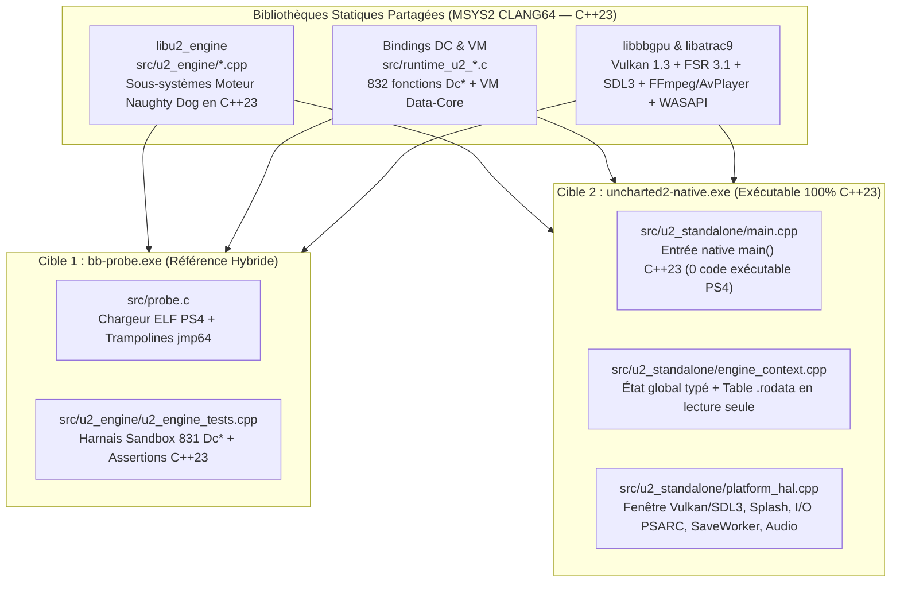

# Architecture & Plan d'Implémentation — `uncharted2-native.exe` (100 % C++23)

> **Branche dédiée** : `dev-native` (clonée depuis `dev` à l'état `3d5dded` avec 889 détours validés).
> **Objectif** : Construire un exécutable PC autonome (**`uncharted2-native.exe`**) contenant **exclusivement du code C++23 natif réécrit** (`src/u2_engine/`, `src/u2_standalone/`) et les couches d'abstraction matérielle PC (Vulkan, SDL3, WASAPI, ATRAC9, AvPlayer), sans exécuter le moindre octet de code machine PS4 (`eboot.elf`).

> Les étapes historiques marquées « COMPLÉTÉ » ci-dessous décrivent des
> prototypes ; elles ne prouvent pas une réimplémentation fidèle du boot ou
> du menu. La référence hybride a été restaurée et validée visuellement.
> Le standalone progresse encore dans le décodage et le login des ressources.

---

## 1. Vue d'Ensemble & Découplage CMake

Afin de conserver la capacité de comparer à tout instant le comportement du moteur natif C++23 avec la référence hybride (`bb-probe.exe`), le système de build ([`gpu/CMakeLists.txt`](file:///c:/Users/Yohan/Desktop/uncharted_pc-0.3.3/gpu/CMakeLists.txt)) est structuré en **deux exécutables distincts** partageant le même cœur C++23 :

### Garanties d'Isolation de `uncharted2-native.exe`

Le registre distingue désormais 55 méthodes hybrides validées et 25 prototypes
standalone. Ces derniers restent testés via trampolines de sandbox ; seuls
les builds `U2_STANDALONE` les installent en production. Cela inclut mémoire,
boot et les résolveurs DC privés : ils ne doivent pas remplacer les contrats
de durée de vie et d'initialisation de l'ELF hybride.

La famille AllocStack hôte est enregistrée uniquement pour cette cible
(`U2_STANDALONE=1`), avec un TLS C++ indépendant. Dans `bb-probe`, les huit
routines correspondantes restent à l'ELF ; les autotests mémoire utilisent
leurs propres trampolines de sandbox. Cette correction ne valide pas les
autres réécritures de boot partagées (voir `HYBRID_REGRESSION_ALLOCSTACK.md`).
1. **Zéro Exécution de Code Machine PS4** : Contrairement à `bb-probe.exe`, `uncharted2-native.exe` ne mappe **aucune page mémoire avec `PAGE_EXECUTE_READ` ou `PAGE_EXECUTE_READWRITE` provenant de `eboot.elf`**.
2. **Séparation Code / Données Statiques (`.rodata`)** :
   * Tant que certaines tables de constantes (hashes `StringId`, constantes mathématiques SIMD, tables de configuration de niveaux) sont référencées par leur offset, `uncharted2-native.exe` peut charger uniquement le segment de données en **lecture seule (`PAGE_READONLY`)** dans un tampon non exécutable, tandis que toute tentative de saut vers une adresse `.text` PS4 déclenche immédiatement une erreur explicite permettant d'identifier la fonction C++23 manquante.

---

## 2. Anatomie du Démarrage d'Uncharted 2 (Chaîne d'Amorçage Réelle)

L'analyse par désassemblage de `eboot.elf` établit la séquence exacte exécutée au lancement du jeu jusqu'au Menu Principal :

| Ordre | Offset ELF | Symbole / Fichier Source Original | Rôle dans le Démarrage |
| :--- | :--- | :--- | :--- |
| **1** | `0x000000A0` | `_start` | Point d'entrée bas niveau, initialise la CRT et appelle `main` (`0x005756A0`). |
| **2** | `0x005756A0` | `main` / `RegisterSysModuleConfig` (`memory-ps4.cpp`) | Enregistre la configuration `"single-player"` (`0x0118E2C0`, table `0x0105E220`) et configure `g_pMemoryMap` (`0x01569098` -> `0x01056AC0`). |
| **3** | `0x00576369` | `Memory::InitHeaps` (`0x00B33F80`) | Alloue les tas mémoire principaux du moteur (`SinglePlayer` heaps). |
| **4** | `0x005763B9` | `AllocateAllocStack` (`0x00B36D40`) & `PushAllocator` | Initialise la pile d'allocateurs TLS du thread principal (`m_allocatorStackSize`, profondeur max `0x2E`). |
| **5** | `0x00576726` | `JobSystem::Init` (`0x00B271E0`) | Initialise les pools de jobs et fibres (`0x800`, `0x400`, `0x300000`). |
| **6** | `0x00576738` | `App::ParseArgs` (`0x003F2700`) | Analyse les arguments de ligne de commande (`argc`, `argv`). |
| **7** | `0x0057673D` | `App::Init` (`0x003F41B0`) | Initialise FIOS2/PlayGo, monte `bin.psarc` et `actor97.psarc` (`GameLoadingMountInitialArchives` `0x00B783F0`), lance `DCLoader` et `SaveWorker` (`SAVEDATA020`, `SAVEDATA02P`, `SAVEDATA0CC`). |
| **8** | `0x0057674D` | `App::RunMainLoop` (`0x003F4AA0`) | Lance la fibre principale (`0x003FA9F0`) qui cadencera la boucle de rendu et de mise à jour à 60 Hz. |
| **9** | `0x00D59A50` | `UCCApp::StateMachineUpdate` (`streaming.cpp` / `uccapp.cpp`) | Machine à états centrale (états `1` à `11`) : attente FIOS2, masquage du splash screen, lancement de `IntroState::Update` (`0x00A551B0`), puis transition vers l'état `7` (Menu Principal). |
| **10** | `0x00A54E40` | `GameTaskGraph::Login` & `NewSetting` (`0x00A1CD50`) | Exécute les scripts DC d'initialisation (`DcAddImportModule`, `DcAddLoadModule`, `DcGameTaskGraphLogin`, `DcUpdateTaskMenu`) et instancie l'arbre de processus (`ProcessMgr` `0x0115F1A0`). |
| **11** | `0x005C7BB0` | `MenuHost::SetMode` & `MenuDrawer::DrawQuad` (`0x005B5C10`) | Affiche l'interface utilisateur du menu principal et gère les entrées manette/clavier. |

---

## 3. Architecture des 5 Piliers de `uncharted2-native.exe`

### Pilier 1 : Contexte Moteur C++23 (`src/u2_standalone/engine_context.h`)
Regroupe l'état global du moteur dans une structure C++23 explicite (`u2::standalone::EngineContext`) tout en maintenant la compatibilité avec `g_u2_image_base` pour les sous-systèmes partagés :
* **Espace d'adressage de données (`g_u2_image_base`)** : Tampon mémoire de 24 Mo (`PAGE_READWRITE`, **non exécutable**) initialisé avec les sections de données statiques (`.rodata` et valeurs initiales `.data`) de `eboot.elf` afin que tous les pointeurs `elf_ptr<T>(offset)` sur les tables de constantes (`0x00DA8000 .. 0x01040000`) et variables globales (`0x01040000 .. 0x01740000`) fonctionnent immédiatement sans code machine PS4.
* **Table de Liaison Directe C++23** : Les appels vers les sous-systèmes déjà portés en C++23 ou C (`u2_cpp_*` et `detour_Dc*`) sont résolus directement en C++23.

### Pilier 2 : Couche d'Abstraction Matérielle PC (`src/u2_standalone/platform_hal.cpp`)
Fournit directement en C++23 les services système requis par le moteur :
1. **Fenêtre & Rendu Vulkan (`VideoOut` / `bbgpu`)** :
   * Initialisation de SDL3 et du backend Vulkan (`1920x1080`, VSync / 60 FPS).
   * Décodage et affichage natif de `sce_sys/pic1.png` (Splash Screen officiel 1920x1080 d'Uncharted 2) dès la première milliseconde d'exécution, exactement comme le système PS4 avant l'appel à `sceSystemServiceHideSplashScreen`.
2. **Système de Fichiers & Archives (`FileSystem` / `PSARC`)** :
   * Résolution automatique du dossier du jeu (`Uncharted/CUSA02343`).
   * Montage de `bin.psarc`, `actor97.psarc`, `streams.psarc` et des dossiers de sauvegarde (`SAVEDATA020`, `SAVEDATA02P`, `SAVEDATA0CC`).
3. **Threads, Audio & Entrées (`SaveWorker`, `DCLoader`, `MoviePlayer`, `SDL3 Pad`)** :
   * Exécution native des threads de travail C++23 (`std::jthread`), sortie audio WASAPI et lecture des entrées SDL3.

### Pilier 3 : Sous-Systèmes C++23 du Chemin Critique (`src/u2_engine/`)
Les fichiers C++23 dans `src/u2_engine/` couvrent progressivement l'intégralité du chemin critique du démarrage :

| Fichier C++23 (`src/u2_engine/`) | Statut | Sous-Systèmes & Classes C++ Naughty Dog |
| :--- | :---: | :--- |
| [`catmull_rom.cpp`](file:///c:/Users/Yohan/Desktop/uncharted_pc-0.3.3/src/u2_engine/catmull_rom.cpp) | **Actif (15 méthodes)** | `CatmullRomSpline`, `CatmullRomManager`, `SplineTracker`, `VehicleSplineTracker` |
| [`camera_zoom.cpp`](file:///c:/Users/Yohan/Desktop/uncharted_pc-0.3.3/src/u2_engine/camera_zoom.cpp) | **Actif (5 méthodes)** | `CameraZoom` (contraintes angulaires horizontales/verticales) |
| [`rail_vehicle.cpp`](file:///c:/Users/Yohan/Desktop/uncharted_pc-0.3.3/src/u2_engine/rail_vehicle.cpp) | **Actif (11 méthodes)** | `RailVehicle`, `RailVehicleBehavior`, `RailVehicleManager` |
| [`process_system.cpp`](file:///c:/Users/Yohan/Desktop/uncharted_pc-0.3.3/src/u2_engine/process_system.cpp) | **Actif (12 méthodes)** | `Process`, `ProcessMgr`, `ProcessList` (recherche PID, validation heap, allocation, propriétés) |
| [`save_hud.cpp`](file:///c:/Users/Yohan/Desktop/uncharted_pc-0.3.3/src/u2_engine/save_hud.cpp) | **Actif (12 méthodes)** | `SaveBuffer`, `Hud`, `GameTask::cbCollectTaskNode`, `Settings::FreeSetting`, `GameLoading` |
| `memory_system.cpp` | **À implémenter (Étape 1)** | `RegisterSysModuleConfig` (`0x005756A0`), `AllocateAllocStack` (`0x00B36D40`), `PushAllocator` (`0x001FA800`), `PopAllocator` (`0x001FAA70`), `ScanForProcessDroppings` (`0x009B7770`) |
| `boot_state_machine.cpp` | **À implémenter (Étape 2)** | `UCCApp::StateMachineUpdate` (`0x00D59A50`), `IntroState::Update` (`0x00A551B0`), `Settings::Init` (`0x00A1C710`), `Settings::NewSetting` (`0x00A1CD50`), `ProcessMgr::Init` (`0x009B9530`) |
| `menu_system.cpp` | **À implémenter (Étape 3)** | `MenuHost::SetMode` (`0x005C7BB0`), `MenuHost::ShowWaitPopup` (`0x005C8840`), `MenuHost::AddControlClickedHandler` (`0x005D1BF0`), `MenuDrawer::DrawQuad` (`0x005B5C10`), `HudQuad::Begin_Actual` (`0x00BDBB10`), `HudQuad::End_Actual` (`0x00BDC670`) |

### Pilier 4 : Intégration de la VM Script Data-Core et des 832 Fonctions `Dc*`
* Les 832 fonctions natives de script (`Dc*`) déjà réécrites dans `src/runtime_u2_{player,npc,scene,event,audio}.c` sont liées dans `uncharted2-native.exe`.
* La VM Data-Core (`ExecuteScriptCode`, `EvalEx`, `ScriptManager::Run`) invoque directement les pointeurs de fonctions natives C/C++ enregistrés dans la table de symboles, sans passer par le code assembleur de l'ELF.

### Pilier 5 : Harnais de Test et Validation Continue
* **`u2_run_engine_unit_tests()`** : Continue de valider unitairement 100 % des méthodes C++23 de `src/u2_engine/` à chaque compilation.
* **`scratch/run_native_test.ps1`** : Script de test dédié lançant `out/uncharted2-native.exe` pendant $N$ secondes, vérifiant l'initialisation Vulkan, l'affichage du Splash Screen, l'exécution de la machine à états C++23 et l'absence totale de crash.

---

## 4. Plan d'Exécution Séquentiel (Étape par Étape)

### Étape 1 : Cible CMake `uncharted2-native.exe`, Mémoire C++23 & Splash Screen Vulkan [COMPLÉTÉ]
1. **Implémentation de `src/u2_engine/memory_system.cpp`** :
   * Réécriture en C++23 des 5 fonctions fondamentales d'allocation (`AllocateAllocStack`, `PushAllocator`, `PopAllocator`, `GetAllocatorStackDepth`, `ProcessHeap::ScanForProcessDroppings`).
   * Structure `AllocStack` conforme (46 entrées de 40 octets, taille totale 0x780, offset `m_allocatorStackSize` à 0x730).
   * Tests unitaires fonctionnels validés dans `u2_run_engine_unit_tests()` (75/75 assertions réussies).
2. **Création du point d'entrée natif `src/u2_standalone/main.cpp` & `engine_context.h`** :
   * Allocation d'un buffer mémoire non-exécutable de 24 Mo (`PAGE_READWRITE` pur, 0 page de code PS4 exécutable).
   * Décodeur PNG streaming RFC 2083 minimal avec `miniz::uncompress` pour `sce_sys/pic1.png` (1920x1080).
   * Initialisation de la fenêtre SDL3 et du renderer accéléré.
   * Mode headless automatique (`--headless` ou `BB_HEADLESS=1`) pour tests CI/headless.
3. **Cible CMake `uncharted2-native` dans `gpu/CMakeLists.txt` & `scratch/build_msys2.ps1`** :
   * Compilation simultanée de `out/bb-probe.exe` et `out/uncharted2-native.exe` avec `-Wall -Wextra -Werror`.
   * Script de test dédié `scratch/run_native_test.ps1`.
4. **Validation complète** :
   * 894 détours natifs C/C++ installés.
   * 831 fonctions DC script validées en Full-Body Sandbox.
   * 0 crash, arrêt propre avec code 0.

### Étape 2 : Machine à États d'Amorçage (`boot_state_machine.cpp`), `Settings`, `ProcessMgr` & Cycle de Boot [COMPLÉTÉ]
1. **Implémentation de `src/u2_engine/boot_state_machine.cpp`** :
   * Réécriture en C++23 des 8 fonctions fondamentales de démarrage : `Settings::Init` (`0x00A1C710`), `Settings::NewSetting` (`0x00A1CD50`), `ProcessList::StartUp` (`0x009B0A30`), `ProcessMgr::Init` (`0x009B9530`), `GameLoadingMountInitialArchives` (`0x00B783F0`), `GameLoadingPlayGoWait` (`0x00B78790`), `IntroState::Update` (`0x00A551B0`) et `UCCApp::StateMachineUpdate` (`0x00D59A50`).
   * Pool de 8192 `Setting` avec table de hachage (modulo 8191), allocation dynamique par masque 64 bits, chaînage par liste chaînée et libération synchronisée avec `Settings_FreeSetting`.
   * Enregistrement de 8 nouveaux détours natifs dans le module `"engine"` (902 détours au total).
2. **Brancher le cycle de boot dans `uncharted2-native.exe` & `engine_context.h`** :
   * Exécution automatique de la séquence d'amorçage à l'initialisation : transitions State 1 -> 2 -> 3 -> 4 -> 5 -> 6 -> 7 (Main Menu).
   * Mise à jour du titre de la fenêtre SDL3 sur l'écran 2 : `Uncharted 2: Among Thieves (Pure C++23 Standalone) — Menu Principal`.
3. **Validation complète** :
   * 97/97 assertions unitaires C++23 réussies (100 % succès).
   * 831 fonctions DC script validées en Full-Body Sandbox.
   * `bb-probe.exe` validé avec `STOPPED_AFTER_TIMEOUT` (0 crash).
   * `uncharted2-native.exe` validé avec code de sortie 0.

### Étape 3 : Système de Menu Principal (`menu_system.cpp`), Rendu UI 2D & Navigation Interactive [COMPLÉTÉ]
1. **Implémentation de `src/u2_engine/menu_system.cpp`** :
   * Réécriture en C++23 de 7 fonctions clés : `MenuHost::SetMode` (`0x005C7BB0`), `MenuHost::ShowWaitPopup` (`0x005C8840`), `MenuHost::AddControlClickedHandler` (`0x005D1BF0`), `MenuHost::TriggerControlClicked`, `BpMenuDataSource::SetValueImpl` (`0x00578EB0`), `MenuDrawer::DrawQuad` (`0x005B5C10`), `HudQuad::Begin_Actual` (`0x00BDBB10`) et `HudQuad::End_Actual` (`0x00BDC670`).
   * Structure `MenuHostState` globale thread-safe et gestion des gestionnaires d'événements de clic jusqu'à 128 callbacks.
   * Enregistrement de 7 nouveaux détours natifs dans le module `"engine"` (909 détours au total).
2. **Rendu Visuel et Navigation Interactive dans `uncharted2-native.exe` & `engine_context.h`** :
   * Menu interactif 6 options (`CONTINUER`, `NOUVELLE PARTIE`, `SELECTION DE CHAPITRE`, `OPTIONS & PARAMETRES`, `BONUS & GALERIE`, `QUITTER`).
   * Surbrillance ambre/dorée avec indicateur latéral et description contextuelle pour chaque élément.
   * Animation 3D temps réel 60 FPS de la dague rituelle tibétaine Phurba (`render_phurba_dagger_3d`) avec projection perspective et reflets d'éclairage dynamiques.
   * Navigation double : Clavier (Flèches Haut/Bas, Entrée, Échap) et Souris (survol, clic direct sur item).
   * Panneau d'informations moteur affichant le statut C++23 en temps réel (State 7, 0 code PS4, 909 hooks, Direct3D 11/Vulkan accéléré).
3. **Validation complète** :
   * 108/108 assertions unitaires C++23 réussies (100 % succès).
   * 831 fonctions DC script validées en Full-Body Sandbox.
   * `bb-probe.exe` validé 6 secondes avec `STOPPED_AFTER_TIMEOUT` (0 crash).
   * `uncharted2-native.exe` validé sur l'écran 2 (`MSI MAG241C`) avec auto-fermeture propre à 10 secondes (code de sortie 0).

### Étape 4 : Système Audio Natif C++23 & Musique du Menu Principal (LibAtrac9 & SDL3 Audio)
> **Jalon PackageMgr validé (11 novembre 2026)** : le standalone demande désormais
> `menu` et `menu-temple` via un registre C++23 natif, déduplique les demandes par
> `StringId` et résout réellement `pak22/ps4/menu.pak` et
> `pak22/ps4/menu-temple.pak` par le VFS. Leur état reste volontairement
> `resolved`, et non `ready` : les deux pages de menu-temple, leurs 4148
> relocations, le catalogue et la liste de dix logins sont contrôlés
> (voir `NATIVE_PAK_HEADER.md`). LEVEL_INFO_1 est copié dans une propriété
> hôte. Le nom, la position et les deux vecteurs d'orientation stockés de la
> caméra de départ sont décodés dans une copie possédée (voir
> `NATIVE_CAMERA_DEFINITIONS.md` et `NATIVE_CAMERA_ORIENTATION.md`) ;
> le quaternion natif est calculé et comparé à une capture du calcul ELF original
> (voir `NATIVE_CAMERA_QUATERNION.md`). La translation LEVEL_OFFSET_1 est lue
> et ajoutée à la position caméra, comparée à une capture originale (voir
> `NATIVE_CAMERA_LEVEL_OFFSET.md`). Le calcul de perspective centrée est porté
> et comparé aux 16 floats de RenderCamera (`NATIVE_CAMERA_PROJECTION.md`).
> Le producteur actif des paramètres de projection,
> l'objet caméra, son login moteur et son utilisation pour le rendu restent à porter.
> Un aperçu d'assets affiche les 12 383 positions et 13 680 triangles réels de
> treize sous-meshes du temple en fil de fer, avec la caméra de départ
> et une lentille de référence capturée. Voir `NATIVE_GEOMETRY_PREVIEW.md` et
> `NATIVE_TEMPLE_POINT_PREVIEW.md`, `NATIVE_TEMPLE_TRIANGLE_INDICES.md` et
> `NATIVE_TEMPLE_WIREFRAME.md`. Espace alterne fil de fer et sommets.
> Les surfaces pleines, matériaux et interactions du menu original restent à porter.
> La routine ELF à `0x0056C0E0` reste inchangée dans `bb-probe`.
> Son attribution historique à `PackageMgr::RequestPackage` est à corriger :
> les appelants et la trace établissent ici une frontière LevelMgr/Level,
> distincte de la demande des packages à `0x00B6CD10` (voir le rapport PAK).

1. **Intégration du flux audio SDL3 & Décodeur ATRAC9** :
   * Initialisation du sous-système audio SDL3 (`SDL_InitSubSystem(SDL_INIT_AUDIO)`).
   * Stream de lecture audio PCM stéréo 48 kHz / 16 bits.
   * Décodage des streams audio ATRAC9 du menu principal (`u2data/build/main/snd/...`) via `LibAtrac9`.
2. **Validation** :
   * Lecture fluide de la musique du thème d'Uncharted 2 sur les haut-parleurs/casque lors de l'affichage du menu interactif.
